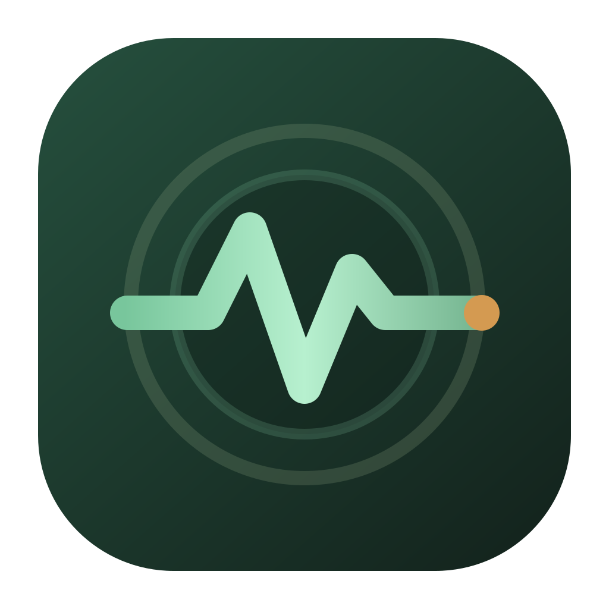

# joi

**A continuously evolving, cross-platform Super Agent with multi-agent orchestration and multi-model support.**

[English](README.md) | [简体中文](README.zh-CN.md)

[](.github/workflows/ci.yml)
[](package.json)
[](package.json)
[](package.json)
[](package.json)
[](package.json)
[](LICENSE)

joi brings multi-agent orchestration, continuous evolution, multiple model sources and desktop, web and Android access into one personal Super Agent. A single global **joi** orchestrator plans with the **Pi** reasoning base, keeps identity, persona, events, memory, routines, work and budgets in a local SQLite database, and dispatches execution to on-device Pi partners or LAN A2A partners inside isolated **workbench** contexts.

- Package name, version and official description: `package.json` (`name`, `version`, `description`).
- Product terms (joi, Pi, Workbench, Partner, Work, WorkResult, harness): `docs/00-sources-and-glossary.md` §0.
- Target architecture decision: [`docs/adr/0002-unique-joi-pi-workbench-orchestration.md`](docs/adr/0002-unique-joi-pi-workbench-orchestration.md).

---

## Table of contents

- [Why joi](#why-joi)
- [Dual evolution: partners that compound, a workbench that learns you](#dual-evolution-partners-that-compound-a-workbench-that-learns-you)
- [Features](#features)
- [Screenshots](#screenshots)
- [Architecture](#architecture)
- [Quick start](#quick-start)
- [Configuration](#configuration)
- [Usage](#usage)
- [Project structure](#project-structure)
- [Tech stack](#tech-stack)
- [Development](#development)
- [Project status](#project-status)
- [Documentation](#documentation)
- [FAQ and troubleshooting](#faq-and-troubleshooting)
- [Contributing](#contributing)
- [License](#license)
- [Acknowledgements](#acknowledgements)

---

## Why joi

joi inherits its engineering goals from an original product rationale captured in [`docs/00-sources-and-glossary.md`](docs/00-sources-and-glossary.md) §2.1:

- Long-horizon work breaks on the turn-based interaction model and on the missing interruption and resume path. Window size is a secondary constraint.
- The subject is the **whole runtime**. The LLM is the reasoning and language organ inside it.
- Human messages, routines, alarms, energy and todos all enter arbitration as **equal events**.
- Continuity comes from persistent memory, residual awareness, todos and self-wake. No single model context is expected to hold it.
- Multi-agent collaboration rests on stable roles, persistent memory and artifact handoff. One-shot sub-agent calls cannot provide that.

This project pursues those engineering goals. It makes no technical claim about "consciousness" or the philosophical definition of life; "life" here means a digital runtime instance with a persistent identity, event-driven wakeups and cross-session continuity.

---

## Dual evolution: partners that compound, a workbench that learns you

Two loops turn at once inside the runtime. One makes the partners joi dispatches work to sharper with every run; the other makes the workbench you share with joi better at reading what you are after. Both end up writing to the same result table.

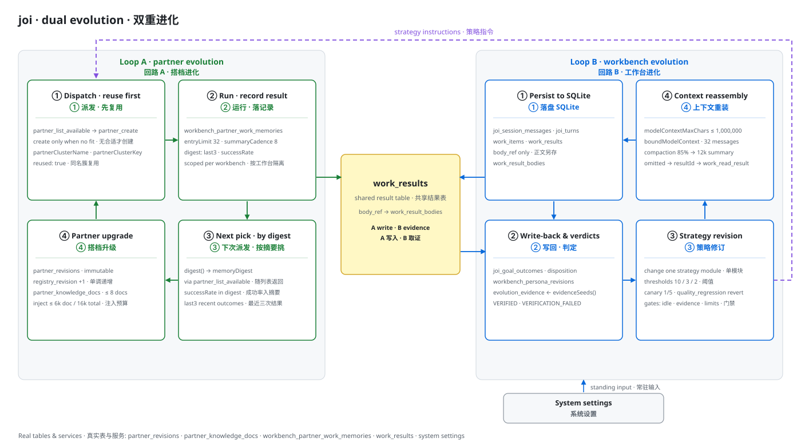

*Two loops, one result table.*

Whatever both loops have learned lives on disk, so closing the app does not reset it.

---

## Features

| Area | What it does | Source |
| --- | --- | --- |
| Home feed | Goal cards (`ARRANGING` / `ARRANGED` / `RUNNING` / `REVIEWING` / `EXTENDING` / `FINALIZING`), "needs you" items and an archive. | `src/main/application/joi/joi-home-feed-service.ts`, `src/renderer/JoiHome.tsx` |
| Workbench management | Create / merge / archive / delete workbenches, bind workspaces, choose an owning workbench when a goal is ambiguous. | `src/main/application/joi/workbench-management-service.ts`, `src/renderer/WorkbenchChoiceDialog.tsx` |
| Partner catalog and instances | Global cwd-less capability templates plus workbench-private instances (`EPHEMERAL` / `RESIDENT`) and scenario preset packs. | `src/main/application/partners/partner-registry-service.ts`, `src/renderer/PartnerPage.tsx` |
| Work items and DAG | Work items with `READ` / `WRITE` / `NONE` access levels, leases, dependency gating and recovery. | `src/main/domain/work/`, `resources/migrations/052_work_dependency_gate.sql` |
| Workbench agent stream | Read-only, safe projection of partner sessions (Markdown, tools, artifacts). | `src/main/application/partners/workbench-agent-service.ts`, `src/renderer/Console.tsx` |
| Routines (scheduled tasks) | The single global Joi scheduler entry point; a routine can open a new goal or continue an existing home goal. | `src/main/application/automation/`, `src/renderer/AutomationPanel.tsx` |
| Statistics | Observed token usage, calendar/hourly heatmaps, model ranking, workbench and high-cost goal breakdowns. | `src/main/application/statistics/`, `src/renderer/StatisticsPage.tsx`, [ADR 0021](docs/adr/0021-token-statistics.md) |
| Bounded evolution | Learns registered context, planning and completion methods from verified task facts. Participating workbenches share a daily call budget; isolated evaluation precedes a 20% production trial and measured promotion. Existing goals retain their pinned method. | `src/main/application/evolution/`, `src/renderer/EvolutionSettings.tsx`, [ADR 0020](docs/adr/0020-bounded-strategy-evolution.md) |
| Skills | Opt-in scanning of `~/.agents/skills`, `~/.claude/skills` and `~/.codex/skills`; disabled by default. | `src/main/infrastructure/skills/local-skill-scanner.ts`, `src/renderer/JoiSkillSettings.tsx` |
| Model sources | Guided onboarding for six vendors plus a generic platform, with API / Coding-Plan / Token-Plan access modes and OpenAI- or Anthropic-compatible protocols. | `src/main/application/model-sources/`, `src/main/domain/model-sources/model-source.ts`, `src/renderer/Onboarding.tsx` |
| Result export | Offline A4 PDF and 1080 px PNG export on desktop and Android. | `src/main/infrastructure/artifacts/electron-result-export.ts`, [docs/19](docs/19-result-export-acceptance.md) |
| Internationalization | Instant UI language switching across desktop, LAN web, remote web and Android, each with its own saved preference. | `resources/locales/`, `src/shared/i18n/`, [docs/20](docs/20-internationalization.md) |
| Android native remote | QR one-time pairing; iroh direct connection first, relay fallback over the internet. | `apps/joi_mobile/`, `native/joi-remote/`, [ADR 0013](docs/adr/0013-native-iroh-remote-control.md) |
| Browser remote relay | A separate Node relay lets a paired browser reach the desktop runtime. | `src/relay/`, [docs/11](docs/11-browser-remote-relay-deployment.md) |

### Core principles

1. **The life subject belongs to the runtime.** An A2A context may expire or be rebuilt; identity and memory must not.
2. **Every stimulus is an event.** User messages get no privilege to bypass the event system and drive the model directly.
3. **Persist first, act second.** Events, actions and invocation state must survive a crash.
4. **One main agent, several collaborators.** The main agent keeps a continuous perspective; collaborators take specific work asynchronously.
5. **Autonomy needs a rhythm.** Self-wakeups, idle exploration and call volume are bounded by budget, quiet hours and an emergency stop.
6. **A2A is an execution protocol.** The hub calls agents over standard A2A and keeps long-term state in the runtime.

---

## Screenshots

The main screens of the joi desktop app.

**1. joi home** — the composer prompt “现在想让 joi 做什么？”

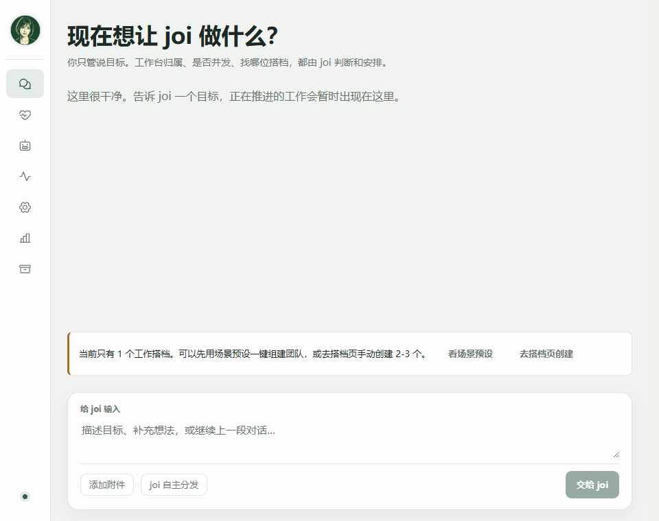

**2. Usage statistics** — daily token trend, calendar heatmap, model ranking, usage composition, top goals and data completeness.

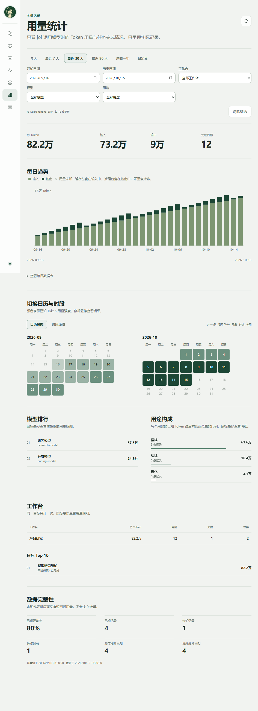

**3. Settings · model network** — first-time connection guidance and a configured model source card.

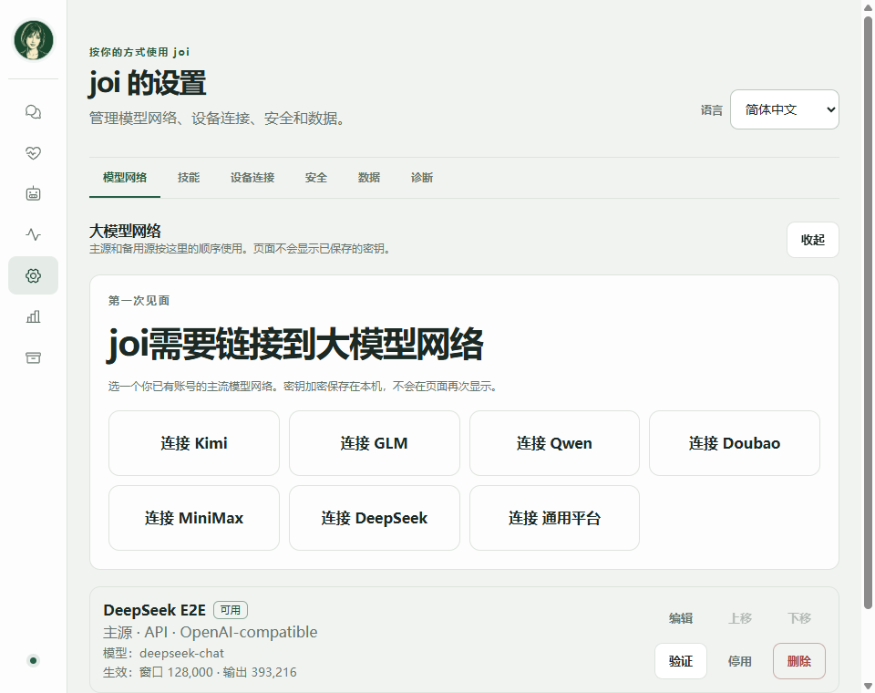

**4. Workbench choice** — the existing workbench list, plus auto-generate and manual creation.

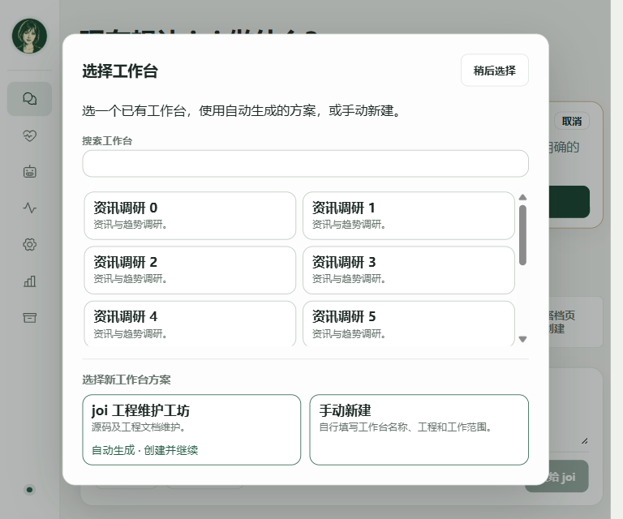

**5. Add partner** — local partner or remote A2A, engine `Pi core`, model name left empty to follow the global preferred model, tool permissions ticked per tool.

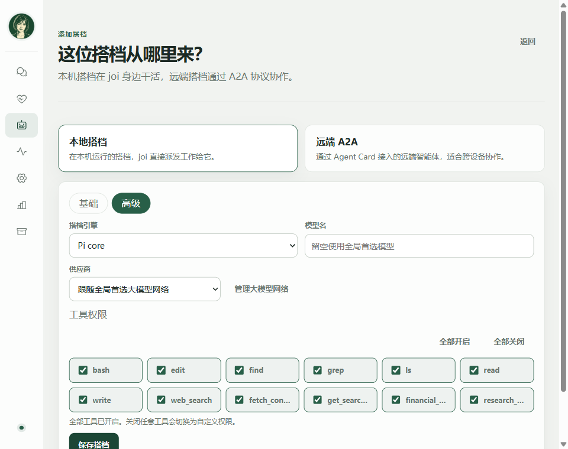

Android native remote control at 390 × 844. Design notes: [`docs/design/joi-android-c-package-verification.md`](docs/design/joi-android-c-package-verification.md).

| Pairing | Home |
| --- | --- |
| 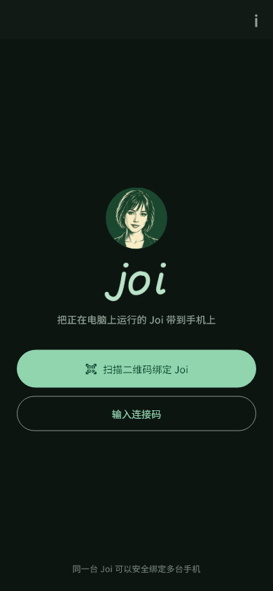 | 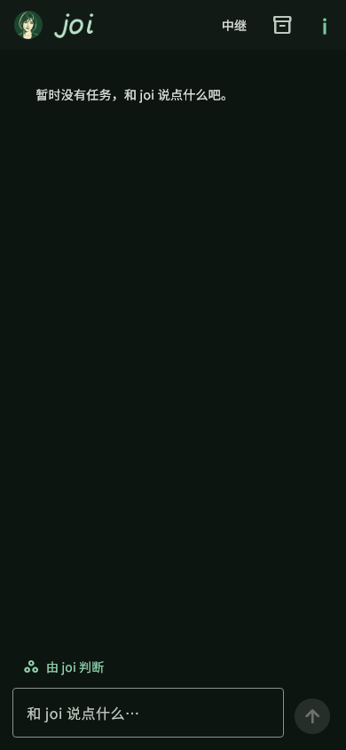 |

---

## Architecture

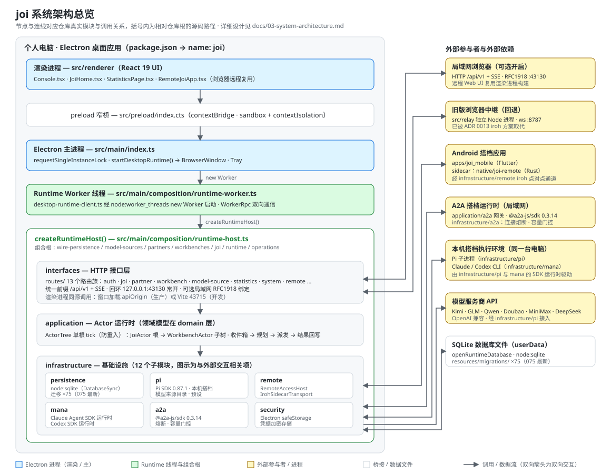

joi is an Electron desktop application with an embedded isomorphic web UI. The main process hosts the resident runtime; the renderer is plain React that talks to the runtime only over `/api/v1`.

The runtime is split into layers whose boundaries are enforced by [`scripts/architecture-boundaries.mjs`](scripts/architecture-boundaries.mjs) and [`AGENTS.md`](AGENTS.md):

| Layer | Responsibility | Examples |
| --- | --- | --- |
| `src/main/domain/` | Pure TypeScript domain models; no Electron, Node runtime APIs, SQLite, HTTP, filesystem or A2A SDK. | `domain/work`, `domain/workbench`, `domain/partners`, `domain/statistics` |
| `src/main/application/` | Orchestrates ports and domain behavior; no transport, SQL, Electron lifecycle or credential storage. | `application/joi`, `application/partners`, `application/actors`, `application/ports` |
| `src/main/infrastructure/` | Implements ports: Pi, SQLite, `safeStorage`, A2A, iroh, artifacts. | `infrastructure/pi`, `infrastructure/persistence`, `infrastructure/remote` |
| `src/main/interfaces/` | Maps the HTTP `/api/v1` API to application services and shared DTOs. | `interfaces/http/routes/` |
| `src/main/composition/` | Composition root and desktop runtime workers. | `composition/runtime-host.ts`, `runtime-worker.ts` |
| `src/renderer/` | React UI using only shared DTOs and `/api/v1`. | `Console.tsx`, `JoiHome.tsx`, `StatisticsPage.tsx` |

Persistence, transport and side effects are each pinned to a specific module:

- Persistence is Node's built-in **`node:sqlite`** `DatabaseSync`: `src/main/infrastructure/persistence/runtime-database.ts`.
- Schema evolves through monotonic SQL migrations in `resources/migrations/` (75 files, highest currently `075_workbench_choice.sql`).
- The hub exposes an HTTP `/api/v1` API, served on loopback by default: `src/main/interfaces/http/runtime-listeners.ts`. The renderer converges state by polling on a fixed cadence; the SSE transport was retired in [ADR 0009](docs/adr/0009-actor-tree-single-root-tick.md).
- Actors converge state through a single root tick: `src/main/application/actors/actor-tree.ts`, [ADR 0009](docs/adr/0009-actor-tree-single-root-tick.md).
- External side effects go through an outbox with stable idempotency identifiers (see [`AGENTS.md`](AGENTS.md), "Development discipline").

Default runtime policy, editable per digital life:

| Item | Default |
| --- | ---: |
| LAN web port | `43130` |
| Main wake concurrency | `1` |
| Collaborator concurrency | `4` |
| Per-endpoint concurrency | `2` |
| Daily autonomous wakeups | `24` |
| Daily A2A calls | `100` |
| Idle-exploration threshold | `120` minutes |
| Daily idle-exploration cap | `3` |
| Quiet hours | `23:00–07:00` |

User messages, user authorization and system recovery do not consume the autonomous-wake budget but still count against concurrency and total call budgets.

---

## Quick start

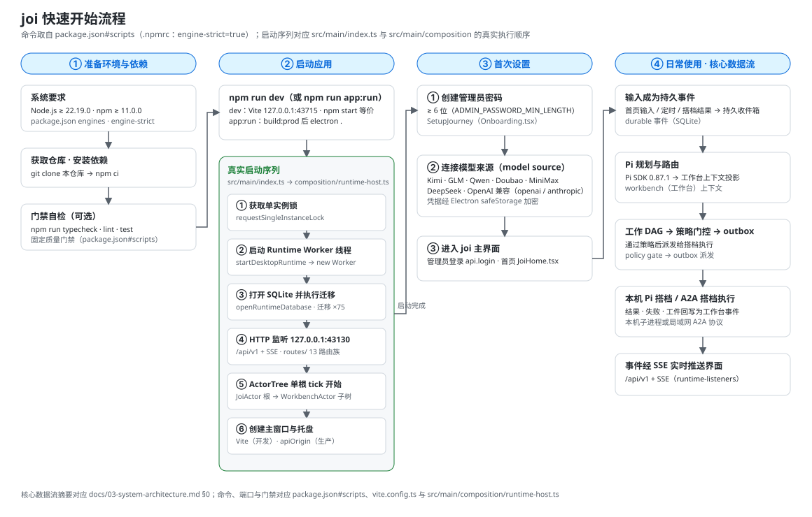

### Prerequisites

- **Node.js** `>=22.19.0` and **npm** `>=11.0.0` — declared in `package.json#engines` and enforced by `engine-strict=true` in [`.npmrc`](.npmrc).
- A graphical desktop session for the Electron window.
- Optional, only for the corresponding builds: a Rust toolchain (`npm run build:native:desktop`), and the Flutter SDK plus Android NDK (`npm run build:mobile:android`).

### Install and run

```bash
# Install dependencies from the lockfile
npm ci

# Development: build the Electron main process, start Vite on 127.0.0.1:43715,
# watch TypeScript, then launch Electron once the dev server is up
npm run dev

# Production form: full build, then run locally with Electron
npm run app:run
```

`npm start` is an alias of `npm run dev` (see `package.json#scripts`). The dev server proxies `/api` to `http://127.0.0.1:43130` (`vite.config.ts`).

### First-time setup

1. Launch the app and complete onboarding: set an administrator password (minimum length `6`, `src/shared/product.ts`).
2. Connect at least one model source before joi can think — six vendors plus a generic platform are supported (`src/main/domain/model-sources/model-source.ts`).
3. Optional: enable LAN access for trusted local browsers, choose the interface language, and opt into skills under Settings.

### Fixed quality gate

Run these before handing off a change ([`AGENTS.md`](AGENTS.md), [`.agent/commands/verify.md`](.agent/commands/verify.md)):

```bash
npm run typecheck
npm run lint
npm run test
npm run test:coverage
npm run test:e2e
npm run build:prod
npm run package:verify
```

`npm run check` chains typecheck, lint, test, coverage, a full build and package verification in one command.

---

## Configuration

### Environment variables

joi has no `.env` file; configuration is either an environment variable or an in-app setting stored in SQLite. These variables are read from source:

| Variable | Purpose | Default | Source |
| --- | --- | --- | --- |
| `JOI_TEST` | Test mode: isolated `userData`, skip the single-instance lock, random loopback port. | unset (treated as `0`) | `src/main/index.ts` |
| `VITE_DEV_SERVER_URL` | Load the Vite dev server instead of the embedded UI. | unset | `src/main/index.ts` |
| `JOI_RELAY_HOST_TOKEN` | Browser relay host token. | `""` | `src/relay/index.ts` |
| `JOI_RELAY_BIND_ADDRESS` | Browser relay bind address. | `127.0.0.1` | `src/relay/index.ts` |
| `JOI_RELAY_PORT` | Browser relay port. | `8787` | `src/relay/index.ts` |
| `JOI_RELAY_STATIC_DIRECTORY` | Browser relay static directory. | `dist/renderer` | `src/relay/index.ts` |
| `JOI_PARTNER_ENV_PASSTHROUGH` | Comma-separated sensitive environment variable names allowed to reach partner shell commands. | `""` | `src/main/infrastructure/pi/pi-coding-tool-factory.ts` |
| `JOI_AGENTS_SKILLS_DIR` | Override the `~/.agents/skills` scan directory. | unset | `src/main/infrastructure/pi/pi-sdk-skill-catalog.ts` |
| `JOI_CLAUDE_SKILLS_DIR` | Override the `~/.claude/skills` scan directory. | unset | `src/main/infrastructure/pi/pi-sdk-skill-catalog.ts` |
| `JOI_CODEX_SKILLS_DIR` | Override the `~/.codex/skills` scan directory. | unset | `src/main/infrastructure/pi/pi-sdk-skill-catalog.ts` |
| `JOI_NATIVE_WRITE_TESTS` | Enable the native write-tool test. | unset (skipped) | `tests/native/local-workspace-write.test.ts` |
| `JOI_NATIVE_TOOL_SMOKE` | Enable the Codex native write-tool smoke test. | unset (skipped) | `tests/native/local-workspace-write.test.ts` |
| `JOI_RELAY_SMOKE_URL` | External acceptance target for the deployed relay (Rust test). | unset (`#[ignore]`) | `native/joi-remote/tests/deployed_relay.rs` |
| `CARGO`, `ANDROID_HOME`, `ANDROID_NDK_HOME` | Locate native build toolchains. | auto-detected | `scripts/build-native-remote.mjs` |
| `CSC_IDENTITY_AUTO_DISCOVERY` | Set to `false` in CI to disable code-signing auto-discovery. | unset | `.github/workflows/ci.yml` |

### Ports

| Port | Purpose | Source |
| --- | --- | --- |
| `43130` | Loopback API/UI port (random ephemeral port when `JOI_TEST=1`). | `src/main/composition/runtime-host.ts` |
| `43715` | Vite dev server, `127.0.0.1`, `strictPort: true`. | `vite.config.ts` |
| `8787` | Browser remote relay default. | `src/relay/index.ts` |
| `43130` | Default LAN web port; only RFC1918 addresses can be selected. | `src/main/infrastructure/operations/system-settings-service.ts`, `src/main/interfaces/http/runtime-listeners.ts` |

### In-app settings

Settings live in SQLite (`src/shared/system-settings.ts`):

- `uiLocale` — `system` / `en` / `zh-CN`.
- LAN listener — enabled flag, chosen RFC1918 address, port and risk acknowledgement.
- `launchAtLogin`.
- `joiSkills` — selected local skill names.
- Model sources, workbench bindings, personas, routines and budgets.

---

## Usage

1. **Open a goal.** Type into the home composer. joi classifies the input, may reuse a matching workbench, and asks you to choose one only when the match is weak or ambiguous.
2. **Watch the plan.** joi plans with Pi and dispatches `Work` items to on-device Pi partners or LAN A2A partners, respecting `READ` / `WRITE` / `NONE` access levels, dependencies and leases.
3. **Follow the workbench agent stream.** Partner sessions are shown as a read-only safe projection; results are archived as workbench-scoped `WorkResult` rows and summarized back to joi.
4. **Answer when asked.** Clarifications and authorization requests surface on the home feed; workbench ownership choices can create a new workbench and continue the same input.
5. **Schedule it.** Create a Routine to open a new goal or continue an existing home goal after its card finishes; scheduled runs reuse the existing single Joi execution slot.
6. **Review and export.** Inspect token usage and heatmaps on the Statistics page, and export a result as A4 PDF or 1080 px PNG.
7. **Go remote (optional).** Pair an Android device by QR code, or run the browser relay for a paired browser.

There is no CLI interface; the desktop window and its embedded web UI are the entry points (`src/main/index.ts`, `src/renderer/main.tsx`).

---

## Project structure

```text
digital-life/
├── .agent/            # Agent-facing command index (dev / verify / i18n / package / clean)
├── .github/workflows/ # CI "quality": windows-latest + macos-latest
├── apps/
│   └── joi_mobile/    # Flutter Android limited remote client
├── docs/              # Product, architecture, protocol and acceptance docs + adr/ + design/
├── native/
│   └── joi-remote/    # Rust iroh remote transport crate
├── public/            # Static favicon
├── resources/
│   ├── branding/      # App icon source (icon.svg / icon.png)
│   ├── fonts/         # Offline export font NotoSansSC.ttf (OFL)
│   ├── licenses/      # Third-party license texts
│   ├── locales/       # Single i18n source: en/ and zh-CN/ (19 namespaces each)
│   └── migrations/    # 75 SQLite migrations + README
├── scripts/           # Build, package, i18n and boundary-audit scripts
├── src/
│   ├── main/          # Electron main process: domain / application / infrastructure / interfaces / composition
│   ├── preload/       # Narrow desktop bridge (index.cts)
│   ├── relay/         # Browser remote relay
│   ├── renderer/      # React isomorphic UI (desktop + LAN + remote web)
│   └── shared/        # Cross-layer DTOs and i18n
├── tests/             # unit / integration / contract / renderer / architecture / native / relay / e2e
├── AGENTS.md          # Repository guide: source of truth, boundaries, fixed commands
├── package.json       # Scripts, dependencies, engines, electron-builder config
└── tsconfig*.json / vite.config.ts / vitest.config.ts / playwright.config.ts
```

---

## Tech stack

| Layer | Technology | Version | Source |
| --- | --- | --- | --- |
| Language | TypeScript | `6.0.3` | `package.json#devDependencies` |
| Desktop shell | Electron | `43.1.1` | `package.json#devDependencies` |
| UI | React + react-dom | `19.2.7` | `package.json#dependencies` |
| Bundler | Vite + `@vitejs/plugin-react` | `8.1.4` / `6.0.3` | `package.json`, `vite.config.ts` |
| UI components | `@radix-ui/themes` | `3.3.0` | `package.json#dependencies` |
| Persistence | Node `node:sqlite` (`DatabaseSync`) | built-in | `src/main/infrastructure/persistence/runtime-database.ts` |
| HTTP | Node `node:http` + `/api/v1` (renderer polls; SSE retired, see [ADR 0009](docs/adr/0009-actor-tree-single-root-tick.md)) | built-in | `src/main/interfaces/http/` |
| Relay WebSocket | `ws` | `^8.18.3` | `package.json#dependencies` |
| Reasoning base | `@earendil-works/pi-agent-core`, `pi-ai`, `pi-coding-agent` | `0.87.1` | `package.json#dependencies` |
| A2A client | `@a2a-js/sdk` | `0.3.14` | `package.json#dependencies` |
| Partner engines | `@anthropic-ai/claude-agent-sdk`, `@openai/codex-sdk` | `0.3.251` / `0.151.0` | `package.json#dependencies` |
| Native transport | Rust crate `joi-remote`, `iroh` | `=1.0.2` | `native/joi-remote/Cargo.toml` |
| Mobile client | Flutter / Dart (`joi_mobile`) | Dart `^3.11.5` | `apps/joi_mobile/pubspec.yaml` |
| Testing | Vitest + `@vitest/coverage-v8`, Playwright | `4.1.10`, `1.61.1` | `package.json`, `vitest.config.ts` |

---

## Development

### Scripts

All commands are defined in `package.json#scripts`.

| Command | Description |
| --- | --- |
| `npm run dev` / `npm start` | Development: build main process, start Vite, watch TypeScript, launch Electron. |
| `npm run app:run` | Full production build, then run locally with Electron. |
| `npm run typecheck` | `tsc -b tsconfig.json`. |
| `npm run lint` | `eslint . --max-warnings 0`. |
| `npm run test` | Vitest run. |
| `npm run test:coverage` | Vitest with coverage. |
| `npm run test:renderer` / `test:integration` / `test:contract` | Targeted test layers. |
| `npm run test:e2e` | Production build then Playwright Electron E2E. |
| `npm run build:prod` | `rimraf dist` then native desktop, renderer, Electron and relay builds. |
| `npm run build:renderer` / `build:electron` / `build:relay` | Individual build targets. |
| `npm run build:native:desktop` | Build the iroh sidecar (requires Rust Cargo). |
| `npm run build:mobile:android` | Build the Android APK (requires Flutter + Android NDK). |
| `npm run check:boundaries` | Enforce the architecture boundaries. |
| `npm run package` / `package:win` / `package:mac` / `package:dir` | electron-builder for the current platform, Windows NSIS, macOS DMG, or an unpacked directory. |
| `npm run package:verify` | Build and audit package contents. |
| `npm run remote:relay` / `remote:relay:package` | Run or package the browser relay. |
| `npm run i18n` / `i18n:check` / `i18n:stats` | Generate, check and report locale coverage. |
| `npm run assets:icons` | Regenerate the app icon. |
| `npm run clean` | Remove rebuildable artifacts. |

### Testing and quality

- Coverage thresholds are `90` for statements, branches, functions and lines (`vitest.config.ts`).
- E2E drives the real Electron window with Playwright (`tests/e2e/`).
- CI runs `npm ci`, `i18n:check`, typecheck, lint, test, coverage, E2E, package verification and an unpacked package build on `windows-latest` and `macos-latest` (`.github/workflows/ci.yml`).

### Internationalization

- The single source of truth is `resources/locales/` (`en/` and `zh-CN/`, 19 namespaces each, plus `manifest.json`).
- `npm run i18n:stats` reports coverage; `npm run i18n:check` is wired as the `prebuild:prod` gate.
- See [`docs/20-internationalization.md`](docs/20-internationalization.md) for architecture and maintenance steps.

### Packaging

- `electron-builder` produces Windows NSIS and macOS DMG installers (`package.json#build`, appId `com.aimana.joi`, output `release-joi/`).
- The Android release APK is written to `release-joi-mobile/` and currently uses a debug signing key (see [`docs/design/joi-android-c-package-verification.md`](docs/design/joi-android-c-package-verification.md)).
- Build outputs and `release-*/` are gitignored; installers are produced locally and are not committed.

---

## Project status

joi is an early-stage project and **not a complete MVP**. Current milestone work uses the JOI-01 M1–M3 plan:

- M1 (W0–W3) and M2 (W4–W5) have in-repository automated evidence.
- M3 has converged the W6 interface and is progressing through W7 compatibility switching, security and release acceptance.

The Electron actor root loop, HTTP control plane, outbox, workbench/Partner/Work, legacy Life read-only compatibility, recovery and packaging chain have automated coverage. The following are **not** verified in the current environment and are not marked as passing: real AI Mana integration, a second LAN device, macOS packaging/signing/notarization, Windows code signing, 24-hour soak, and manual keyboard/contrast visual acceptance.

See the [release validation report](docs/09-release-validation-report.md) and the [roadmap and acceptance](docs/07-roadmap-and-acceptance.md) for the full criteria.

---

## Documentation

Product and architecture documentation lives under `docs/`:

- [Sources and glossary](docs/00-sources-and-glossary.md)
- [Product requirements](docs/01-product-requirements.md)
- [UX specification](docs/02-ux-specification.md)
- [System architecture](docs/03-system-architecture.md)
- [Domain and runtime](docs/04-domain-and-runtime.md)
- [A2A integration](docs/05-a2a-integration.md)
- [Security and operations](docs/06-security-and-operations.md)
- [Roadmap and acceptance](docs/07-roadmap-and-acceptance.md)
- [Reference backend assessment](docs/08-reference-backend-assessment.md)
- [Release validation report](docs/09-release-validation-report.md)
- [Requirements traceability](docs/10-requirements-traceability.md)
- [Browser remote relay deployment](docs/11-browser-remote-relay-deployment.md)
- [Native iroh relay deployment](docs/12-native-iroh-relay-deployment.md)
- [Native Android remote manual test](docs/13-native-android-remote-manual-test.md)
- [Multi-agent runtime assessment](docs/14-joi-multi-agent-runtime-assessment.md)
- [Agent core completeness](docs/15-agent-core-completeness.md)
- [Result export acceptance](docs/19-result-export-acceptance.md)
- [Internationalization](docs/20-internationalization.md)
- Architecture decision records: [`docs/adr/`](docs/adr/)

Agent-facing command index: [`.agent/commands/`](.agent/commands/README.md).

---

## FAQ and troubleshooting

**Does joi need a cloud account or a remote backend?**
No. The runtime, SQLite database and credentials live on your machine. The only network calls are to the model sources you configure and to A2A partners you add.

**Where are my credentials stored?**
Through Electron `safeStorage` (`src/main/infrastructure/security/electron-credential-vault.ts`). If `safeStorage` is unavailable, joi blocks new agent calls rather than storing secrets in the clear.

**Is there a CLI?**
No. joi has no command-line interface; it runs as a desktop app with an embedded web UI.

**The LAN port is already in use.**
joi stops the LAN listener and keeps loopback running. Free the port or choose another one, then retry (`docs/06-security-and-operations.md` §12).

**A migration failed.**
joi enters read-only recovery mode. Export diagnostics and restore from a backup (`docs/06-security-and-operations.md` §12).

**Are the installers signed?**
No. Installers are produced locally and are currently unsigned; macOS signing/notarization and Windows signing are not yet performed. See [Project status](#project-status).

**Where is the data stored?**
In Electron `userData` (SQLite database, artifacts and backups). Tests always use disposable temp directories and never read your real `userData`.

**Why is there no `.env` file?**
joi reads a small set of environment variables and otherwise stores settings in SQLite. There is no `.env.example` in the repository; do not expect `.env` loading.

---

## Contributing

1. Map every behavior change to a documented acceptance criterion.
2. Add and run a failing test before implementing.
3. Keep external side effects behind an outbox with stable idempotency identifiers.
4. Use disposable SQLite, `userData` and credential fakes in tests — never read real Electron `userData`.
5. Never log or return tokens, cookies, CSRF values, message bodies, persona, memory text or A2A payloads.
6. Run the [fixed validation commands](#fixed-quality-gate) before handing off a milestone.
7. Respect the layer boundaries in [`AGENTS.md`](AGENTS.md) and classify every new production directory in `scripts/architecture-boundaries.mjs`.

See [`AGENTS.md`](AGENTS.md) for the full repository guide and [`.agent/commands/`](.agent/commands/README.md) for the command index.

---

## License

**joi is released under the Apache License, Version 2.0** — the full text ships in [`LICENSE`](LICENSE), and the canonical copy is published at <https://www.apache.org/licenses/LICENSE-2.0>. Copyright 2026 aimana.

Third-party license texts that are bundled with the project live under `resources/licenses/` (for example the MIT-licensed AI Berkshire scene pack), and the offline font `resources/fonts/NotoSansSC.ttf` is licensed under the SIL Open Font License 1.1 (`resources/fonts/OFL.txt`). Those bundled components keep their own licenses.

You may use, modify and redistribute the project under Apache-2.0, including its express patent grant (Section 3); Sections 7 and 8 disclaim warranty and liability.

---

## Acknowledgements

- **Pi** agent runtime — `@earendil-works/pi-agent-core`, `pi-ai`, `pi-coding-agent`.
- **A2A Protocol** and its JavaScript SDK — `@a2a-js/sdk` `0.3.14`.
- **Claude Agent SDK** and **Codex SDK** for native partner engines.
- **iroh** for peer-to-peer remote transport.
- **Flutter** for the Android remote client.
- **Noto Sans SC** (SIL OFL 1.1) for offline export.
- The **AI Berkshire** scene pack, bundled under its MIT license.
