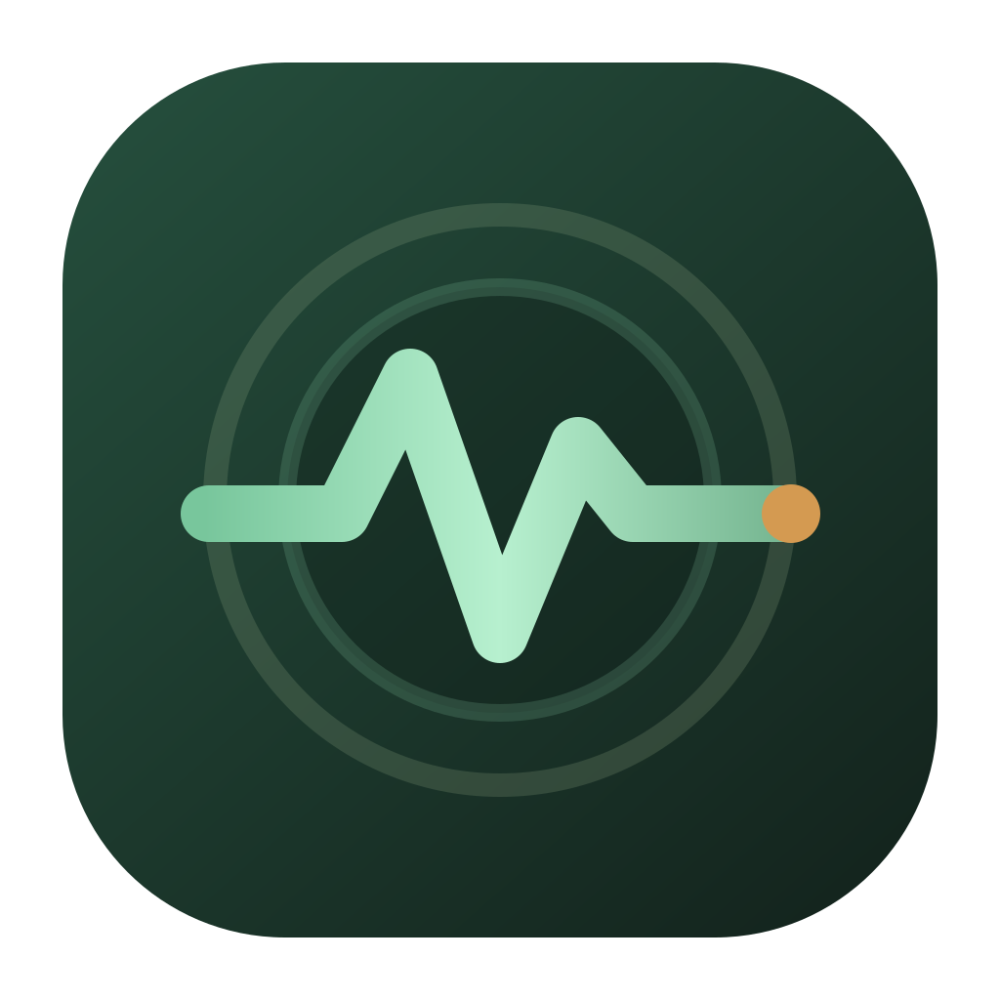
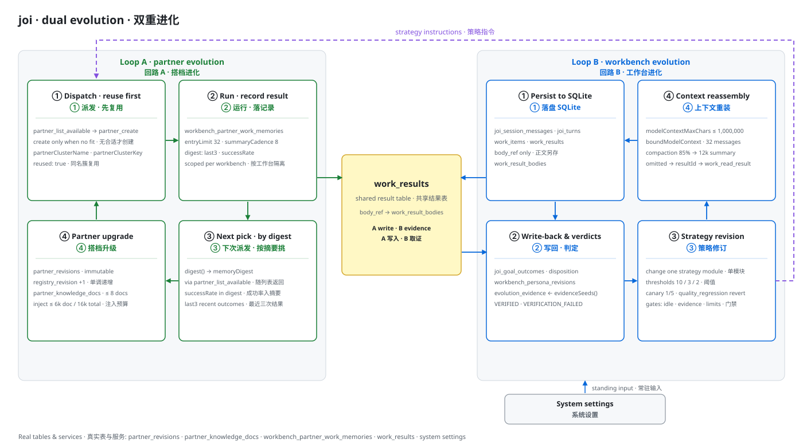
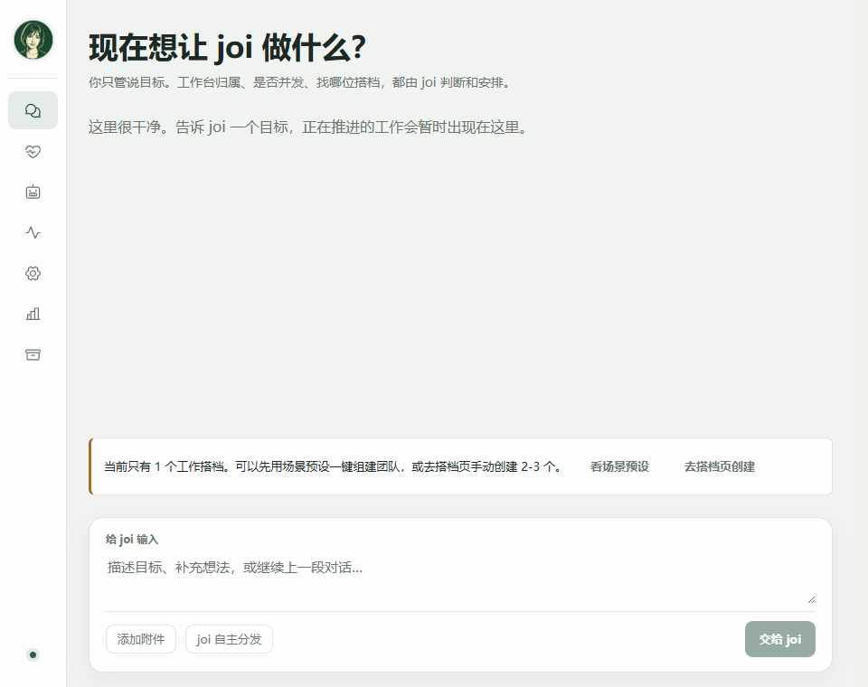
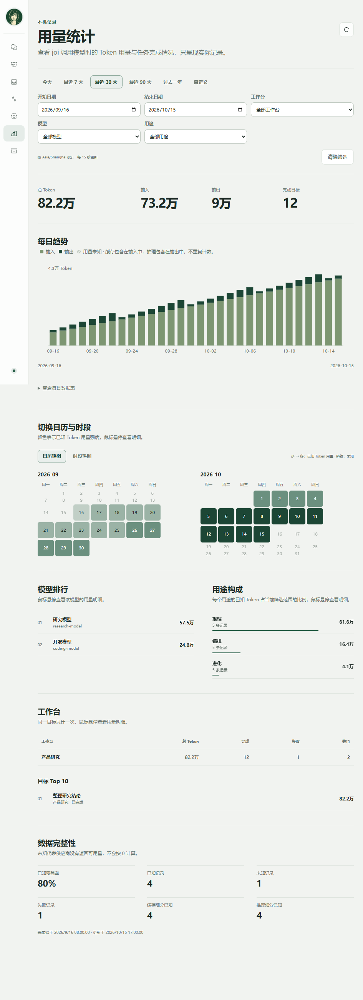
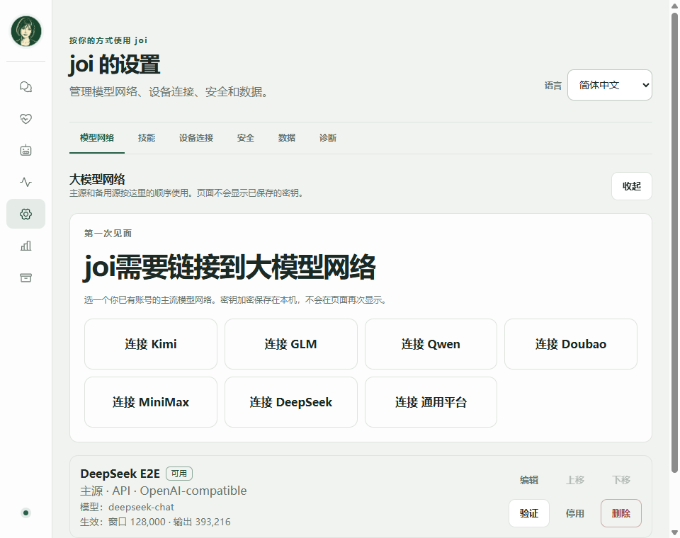
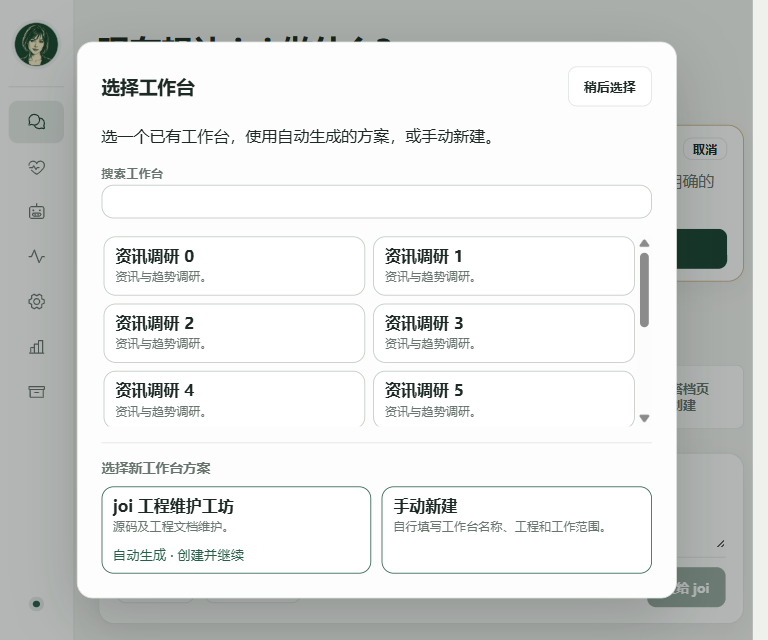
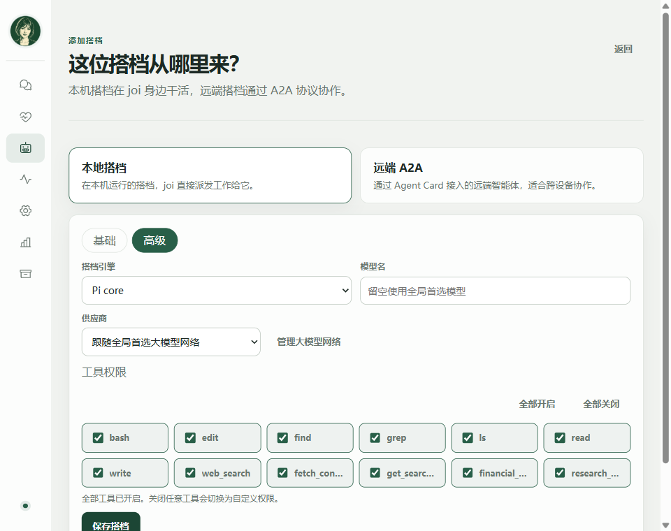
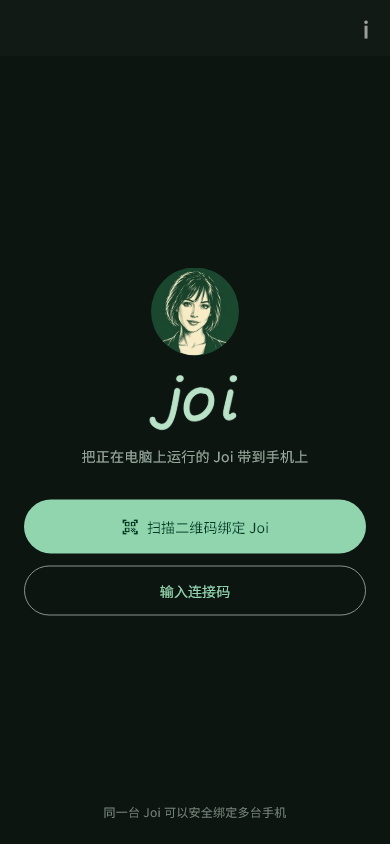
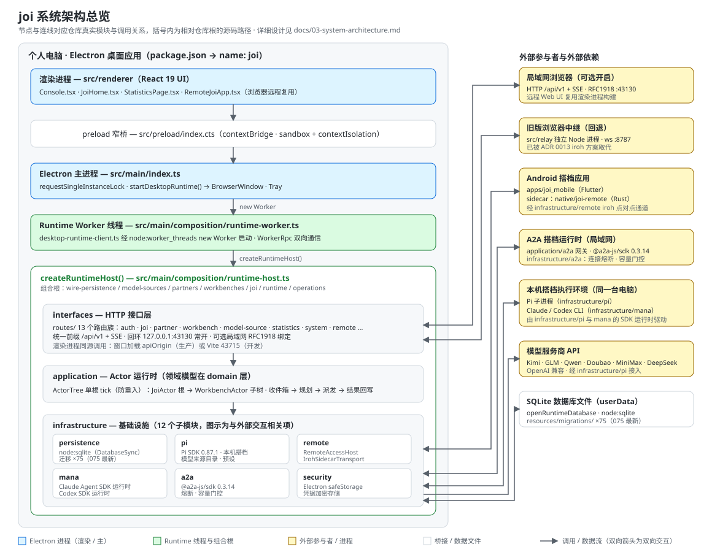
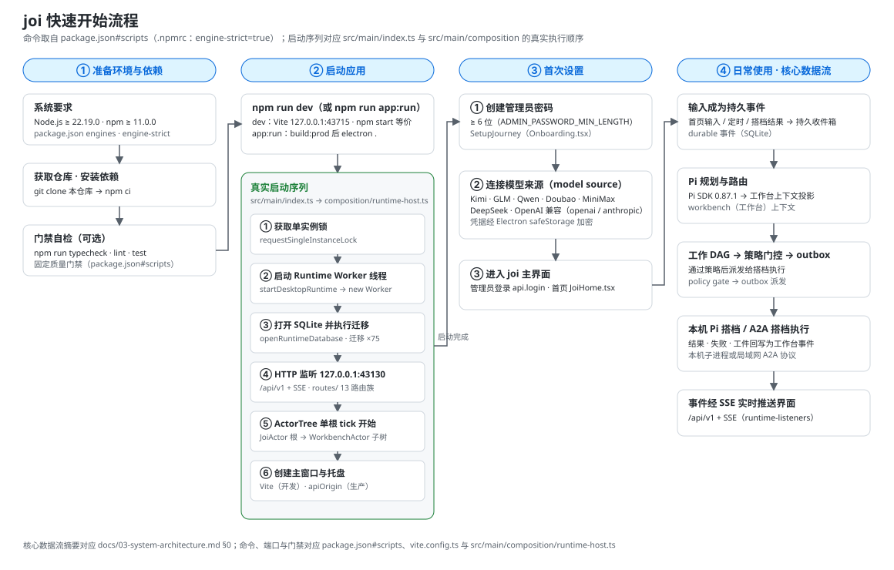

# joi

**运行在个人电脑上的常驻、事件驱动数字生命 Runtime Hub。**

[English](README.md) | [简体中文](README.zh-CN.md)

[](.github/workflows/ci.yml)
[](package.json)
[](package.json)
[](package.json)
[](package.json)
[](package.json)
[](LICENSE)

joi 运行在你自己的电脑上，是一个长期在线的 Runtime：常驻中枢，身份、记忆与工作台都活得比任何一次会话更久。唯一全局 **joi** 编排者使用 **Pi** 推理基座进行规划，把身份、人格、事件、记忆、作息、事务与预算保存在本地 SQLite 中，并在彼此隔离的**工作台（Workbench）**上下文里，把执行派给本机 Pi 搭档或局域网 A2A 搭档。

- 包名、版本与官方描述：`package.json`（`name`、`version`、`description`）。
- 产品术语（joi、Pi、Workbench、Partner、Work、WorkResult、harness）：`docs/00-sources-and-glossary.md` §0。
- 目标架构决策：[`docs/adr/0002-unique-joi-pi-workbench-orchestration.md`](docs/adr/0002-unique-joi-pi-workbench-orchestration.md)。

---

## 目录

- [为什么做 joi](#为什么做-joi)
- [双重进化：搭档越用越强，工作台越用越懂你](#双重进化搭档越用越强工作台越用越懂你)
- [核心特性](#核心特性)
- [截图](#截图)
- [架构](#架构)
- [快速开始](#快速开始)
- [配置](#配置)
- [使用方式](#使用方式)
- [目录结构](#目录结构)
- [技术栈](#技术栈)
- [开发](#开发)
- [项目状态](#项目状态)
- [文档](#文档)
- [常见问题与故障排查](#常见问题与故障排查)
- [贡献](#贡献)
- [许可证](#许可证)
- [致谢](#致谢)

---

## 为什么做 joi

joi 的工程目标继承自 [`docs/00-sources-and-glossary.md`](docs/00-sources-and-glossary.md) §2.1 记录的产品立论：

- 超长期任务的核心障碍是回合制交互与缺少中断、恢复路径，上下文窗口只是次要约束。
- 主体是**整个运行时**，LLM 是其中的推理与语言器官。
- 人类消息、作息、闹钟、精力与待办都作为**平等事件**进入仲裁系统。
- 连续性来自持久记忆、意识残留、待办与自我唤醒，不需要任何单一模型上下文独自承担。
- 多 Agent 协作以稳定角色、持续记忆和产出物交接为基础，一次性 SubAgent 调用给不了这些。

本项目追求上述工程目标，但不对“意识”或“生命”的哲学命题作技术证明。这里的“生命”是指具有持久身份、事件驱动唤醒和跨会话连续性的数字运行实例。

---

## 双重进化：搭档越用越强，工作台越用越懂你

joi 想兑现的承诺是越用越会配合你。运行时里同时跑着两条进化回路：一条把每个**搭档**磨得更锋利，另一条让与你共享的**工作台**更懂你，两条回路最终落在同一张结果表上。「搭档越配合越强」与「工作台越用越懂你」说的是同一套机制的两面。



*两条回路，一张结果表。图源：[`docs/assets/dual-evolution.svg`](docs/assets/dual-evolution.svg)。*

### 回路 A · 搭档：派发、自动生成、越配越强

1. 配合就是派发。一个请求会被拆成 Work 工作项，每项都有独立的访问等级、执行需求与依赖边。`resources/migrations/052_work_dependency_gate.sql` 在派发时强制依赖 DAG：上游未完成，下游不可领取；依赖失败则确定性地级联取消（`src/main/domain/work/work.ts`）。独立的 AFK 工作并行铺开，且 joi 绝不会把两个搭档放在同一个工作单元上（`src/main/application/joi/joi-system-prompt.ts`）。没有至少一条可机械校验的验收检查，Work 就不允许派发，编排服务会以 `work_acceptance_checks_required` 拒绝（`src/main/application/work/work-orchestration-service.ts`），每条结果随后按这些检查逐条核验（`resources/migrations/035_work_brief_verification.sql`）。搭档是模板，实例才是运行中的会话：`partner_instances` 同时支持用完即弃的 `EPHEMERAL` 与常驻复用的 `RESIDENT`，上限为全局 12 个、单个搭档 4 个（`src/main/application/partners/partner-instance-manager.ts`）。

2. 没有合适的搭档时，joi 就造一个能力簇。joi 先调 `partner_list_available` 尽量复用现成搭档，只有当真的没有合适者时才 `partner_create`（`src/main/application/joi/joi-system-prompt.ts`）。新搭档按可持续复用的能力簇命名，绝不按一次性任务、模型或版本命名：「模型调研搭档」可以，「Grok4.6 模型调研搭档」不行。`partnerClusterName` / `partnerClusterKey`（`src/main/domain/workbench/workbench-naming.ts`）会归一化名称、剥掉一次性模型 token，同名簇直接返回已有搭档而不是复制一份。省略 `modelSourceId` 与 `modelIdOverride`，新搭档就跟随全局首选模型源（`src/main/infrastructure/pi/joi-reasoning-tools.ts`）。joi 创建的每个搭档都会打上 `created_by = 'JOI'`（`resources/migrations/023_partner_config_extensions.sql`），它组起来的团队因此始终可见、可审计。

3. 每次运行都留记录，记录决定下一次选谁。运行结束时 `recordResult()` 追加真实结果、把记录裁剪到 32 条、每 8 条刷新一次滚动摘要；`digest()` 返回最近三条结果与一个由真实记录算出的 `successRate`（`src/main/application/partners/partner-work-memory-service.ts`）。这份摘要随每次 `partner_list_available` 一起返回，工具描述的原话就是「用摘要来挑」（`src/main/infrastructure/pi/joi-reasoning-tools.ts`），所以证据决定选谁。记忆按「工作台 × 搭档」隔离（`resources/migrations/027_avatar_private_partner_results.sql`）：在 A 工作台表现出色的搭档，借不到那份声誉到 B 工作台。知识在旁边累积，每个搭档最多 8 篇文档、单篇 6,000 字符、每次注入预算 16,000 字符（`src/main/application/partners/partner-knowledge-service.ts`）。能力、工具、技能与模型绑定全部版本化：任何改动都会新建一个不可变 revision 并把 `active_revision_id` 指过去，历史结果永远对得上当时的行为体（`src/main/application/partners/partner-registry-service.ts`）。成长是真的，而且可追溯。

### 回路 B · 工作台：上下文活得比会话更久

4. 上下文会持久化，单次请求则有边界。会话、轮次、收件消息、Work 工作项与结果全部落在本地 SQLite 数据库里，结果正文只存引用（`work_results.body_ref` → `work_result_bodies`），不塞进对话记录（`resources/migrations/017_joi_orchestration.sql`、`resources/migrations/027_avatar_private_partner_results.sql`）。生效需求会被固化成版本化契约（`joi_goal_requirements`，`GOAL_REQUIREMENTS_MAX_CHARS = 16_000`），契约未就绪时编排器拒绝派发（`src/main/application/work/work-orchestration-service.ts`）。每次派发前，`WorkbenchContextAssembler.assemble()` 都会写下这次派发所见的世界快照（人设版本、工作区引用、记忆摘要引用），并钉在该次运行上（`src/main/application/joi/workbench-context-assembler.ts`）。这些都不会因为一次会话结束而消失：每轮都按当前模型窗口重新装配上下文，上限 1,000,000 字符与 32 条消息，且永远不丢开头的 system 消息与最新的用户回合（`src/main/infrastructure/pi/pi-model-budget.ts`）。放不下的历史会被显式说明，任何被丢掉的结果都能用 `work_read_result` 按 id 取回。

5. 工作台自身也在进化，人设、记忆、工作区与结构都会随使用变化。工作台持有版本化的人设正文（`workbench_persona_revisions`）、自己的记忆命名空间（`workbenches.memory_namespace_id`，实体在 `memory_fragments` 并由 FTS5 提供全文检索，见 `resources/migrations/004_continuity.sql`），以及一个由 joi 托管或绑定到你已有目录的工作区（`workbench_workspace_bindings`，`kind IN ('MANAGED','BOUND')`）。它的形态跟着你的使用走：活跃工作与近期结果持续投影到 `workbench_task_projections`。当一个工作台完成使命，joi 会**建议**合并或归档（`WorkbenchChangeService.suggestMerge` / `suggestArchive`），你确认之前什么都不会发生（`resources/migrations/019_avatar_change_confirmation.sql`）。学习永远不会改写你是谁：人设与范围始终由用户管理，任何学到的策略都不得扩大你的范围（`src/main/application/joi/joi-system-prompt.ts`）。

6. 两条回路在结果表上交汇：结果变成证据，证据变成下一次简报。`SqliteEvolutionStore.evidenceSeeds()` 只从权威且不迟到的结果取证（`is_authoritative = 1 AND is_late = 0`，权威标记见 `resources/migrations/034_work_goal_binding_and_result_authority.sql`），且只取被钉为可评估的目标（`src/main/infrastructure/persistence/sqlite-evolution-store.ts`）。证据池攒够 10 个可客观评估的目标才允许推进，失败与回滚阈值分别是 3 和 2（`src/shared/evolution.ts`）；一次策略修订只改一个策略模块（`src/main/domain/evolution/strategy.ts`），并经 `strategyForGoal()` 以金丝雀取样方式进入下一次派发（`src/main/application/evolution/evolution-service.ts`）。运行时提示词把层级写得毫不含糊：`Runtime strategy (subordinate to user requirements and fixed gates)`。于是闭环成立：工作台的策略改变 joi 拆解与撰写简报的方式 → 简报改变搭档收到的指令与它持有的工具技能 → 搭档的结果改变它的成功率与记忆 → 成功率改变 joi 下一次选谁 → 而新的结果又成为新的证据。**多合作一次，下一次就选得更准；多做完一个目标，下一次就交代得更准。**

成功率由你自己的运行历史在运行时算出，没有任何预先固定的数字。单次请求被限制在 1,000,000 字符与 32 条消息，持久化则来自磁盘上的数据库。进化只推动策略与配置，前面有证据阈值、金丝雀取样与回滚，且始终从属于你的需求。

---

## 核心特性

| 领域 | 能力 | 来源 |
| --- | --- | --- |
| 首页信息流 | 目标卡（`ARRANGING` / `ARRANGED` / `RUNNING` / `REVIEWING` / `EXTENDING` / `FINALIZING`）、“需你处理”和归档。 | `src/main/application/joi/joi-home-feed-service.ts`、`src/renderer/JoiHome.tsx` |
| 工作台管理 | 创建 / 合并 / 归档 / 删除工作台、绑定工作区、目标归属歧义时选择工作台。 | `src/main/application/joi/workbench-management-service.ts`、`src/renderer/WorkbenchChoiceDialog.tsx` |
| 搭档目录与实例 | 全局无 cwd 能力模板，以及工作台私有实例（`EPHEMERAL` / `RESIDENT`）和场景预设包。 | `src/main/application/partners/partner-registry-service.ts`、`src/renderer/PartnerPage.tsx` |
| Work 工作项与 DAG | 带 `READ` / `WRITE` / `NONE` 访问等级、lease、依赖门控与恢复的 Work 工作项。 | `src/main/domain/work/`、`resources/migrations/052_work_dependency_gate.sql` |
| 工作台 Agent 会话流 | 搭档会话的只读安全投影（Markdown、工具、产物）。 | `src/main/application/partners/workbench-agent-service.ts`、`src/renderer/Console.tsx` |
| 定时任务 Routine | 唯一全局 Joi scheduler 入口；Routine 可创建新目标，也可在既有首页目标卡收官后继续同一目标。 | `src/main/application/automation/`、`src/renderer/AutomationPanel.tsx` |
| 统计 | 本机已观测的 Token 用量、日历/时段热力图、模型排名、工作台与高消耗目标。 | `src/main/application/statistics/`、`src/renderer/StatisticsPage.tsx`、[ADR 0021](docs/adr/0021-token-statistics.md) |
| 有界自主进化 | 可选的上下文整理与完成检查策略改进，每日模型调用额度提供关/低/中/高四档，含灰度与评测进度。 | `src/main/application/evolution/`、`src/renderer/EvolutionSettings.tsx`、[ADR 0020](docs/adr/0020-bounded-strategy-evolution.md) |
| 技能 | 按需扫描 `~/.agents/skills`、`~/.claude/skills` 和 `~/.codex/skills`，默认不加载。 | `src/main/infrastructure/skills/local-skill-scanner.ts`、`src/renderer/JoiSkillSettings.tsx` |
| 模型来源 | 六家厂商加一个通用平台的引导连接，区分 API / Coding-Plan / Token-Plan 访问方式，以及 OpenAI- 或 Anthropic-compatible 协议。 | `src/main/application/model-sources/`、`src/main/domain/model-sources/model-source.ts`、`src/renderer/Onboarding.tsx` |
| 结果导出 | 桌面与 Android 端离线导出 A4 PDF 与 1080px PNG。 | `src/main/infrastructure/artifacts/electron-result-export.ts`、[docs/19](docs/19-result-export-acceptance.md) |
| 国际化 | 桌面、局域网网页、远程网页与 Android 即时切换界面语言，各端独立保存偏好。 | `resources/locales/`、`src/shared/i18n/`、[docs/20](docs/20-internationalization.md) |
| Android 原生远程 | 二维码一次性绑定；同网优先 iroh 直连，公网自动回退中继。 | `apps/joi_mobile/`、`native/joi-remote/`、[ADR 0013](docs/adr/0013-native-iroh-remote-control.md) |
| 浏览器远程中继 | 独立的 Node 中继服务，让已配对的浏览器访问桌面运行时。 | `src/relay/`、[docs/11](docs/11-browser-remote-relay-deployment.md) |

### 核心原则

1. **生命主体属于 Runtime。** A2A context 可以过期或重建，身份与记忆不能随之丢失。
2. **所有刺激都是事件。** 用户消息没有绕过事件系统直接驱动模型的特权。
3. **先持久化，再行动。** 事件、动作和调用状态必须能够在崩溃后恢复。
4. **一个主 Agent，多名协作者。** 主 Agent 维持连续视角，协作者按能力异步承接具体工作。
5. **自治必须有节奏。** 自主唤醒、空闲探索和调用量受预算、安静时段和紧急停止控制。
6. **A2A 是执行协议。** Hub 通过标准 A2A 调用 Agent，长期状态留在运行时里。

---

## 截图

joi 桌面应用的五个主要界面。

**1. joi 主页** —— composer「现在想让 joi 做什么？」签名界面。



**2. 用量统计** —— 每日趋势、日历热力图、模型排行、用途构成、目标 Top 10 与数据完整性。



**3. 设置 · 模型网络** —— 首次接入引导与已配置的模型源卡片。



**4. 选择工作台** —— 已有工作台列表，以及自动生成与手动新建两种新建方式。



**5. 添加搭档** —— 本地搭档或远端 A2A、引擎 `Pi core`，模型名留空即跟随全局首选，工具权限按项勾选。



Android 原生远程控制端，390 × 844。设计说明见 [`docs/design/joi-android-c-package-verification.md`](docs/design/joi-android-c-package-verification.md)。

| 配对页 | 首页 |
| --- | --- |
|  |  |

---

## 架构



joi 是 Electron 桌面应用，内嵌同构 Web UI。主进程承载常驻 Runtime；渲染进程是普通 React，只通过 `/api/v1` 与运行时通信。

运行时按层拆分，边界由 [`scripts/architecture-boundaries.mjs`](scripts/architecture-boundaries.mjs) 与 [`AGENTS.md`](AGENTS.md) 强制：

| 层 | 职责 | 示例 |
| --- | --- | --- |
| `src/main/domain/` | 纯 TypeScript 领域模型；不导入 Electron、Node 运行时 API、SQLite、HTTP、文件系统或 A2A SDK。 | `domain/work`、`domain/workbench`、`domain/partners`、`domain/statistics` |
| `src/main/application/` | 编排 ports 与领域行为；不实现传输、SQL、Electron 生命周期或凭据存储。 | `application/joi`、`application/partners`、`application/actors`、`application/ports` |
| `src/main/infrastructure/` | 实现 ports：Pi、SQLite、`safeStorage`、A2A、iroh、artifact。 | `infrastructure/pi`、`infrastructure/persistence`、`infrastructure/remote` |
| `src/main/interfaces/` | 把 HTTP `/api/v1` API 映射到应用服务与共享 DTO。 | `interfaces/http/routes/` |
| `src/main/composition/` | 组合根与桌面 runtime worker。 | `composition/runtime-host.ts`、`runtime-worker.ts` |
| `src/renderer/` | 仅使用共享 DTO 与 `/api/v1` 的 React UI。 | `Console.tsx`、`JoiHome.tsx`、`StatisticsPage.tsx` |

持久化、传输与副作用都落在具体模块上：

- 持久化使用 Node 内置的 **`node:sqlite`** `DatabaseSync`：`src/main/infrastructure/persistence/runtime-database.ts`。
- Schema 通过单调版本的 SQL migration 演进，位于 `resources/migrations/`（共 75 个文件，当前最大为 `075_workbench_choice.sql`）。
- Hub 暴露 HTTP `/api/v1` API，默认只监听 loopback：`src/main/interfaces/http/runtime-listeners.ts`。renderer 按固定节奏轮询收敛状态；SSE 传输已于 [ADR 0009](docs/adr/0009-actor-tree-single-root-tick.md) 退役。
- actor 通过单一 root tick 收敛状态：`src/main/application/actors/actor-tree.ts`、[ADR 0009](docs/adr/0009-actor-tree-single-root-tick.md)。
- 外部副作用先进入 outbox，并使用稳定幂等标识（见 [`AGENTS.md`](AGENTS.md) 的 “Development discipline”）。

默认策略如下，可按数字生命单独修改：

| 项目 | 默认值 |
| --- | ---: |
| 局域网 Web 端口 | `43130` |
| 单生命主唤醒并发 | `1` |
| 协作者并发 | `4` |
| 单 Endpoint 并发 | `2` |
| 每日自主唤醒额度 | `24` |
| 每日 A2A 调用额度 | `100` |
| 空闲探索门槛 | `120` 分钟 |
| 每日空闲探索上限 | `3` |
| 默认安静时段 | `23:00–07:00` |

用户消息、用户授权和系统恢复不消耗“自主唤醒”额度，但仍受并发和总调用额度约束。

---

## 快速开始



### 环境要求

- **Node.js** `>=22.19.0` 与 **npm** `>=11.0.0` —— 由 `package.json#engines` 声明，并由 [`.npmrc`](.npmrc) 的 `engine-strict=true` 强制校验。
- 运行 Electron 窗口需要图形桌面会话。
- 以下仅在对应构建时需要：Rust 工具链（`npm run build:native:desktop`），以及 Flutter SDK 与 Android NDK（`npm run build:mobile:android`）。

### 安装与运行

```bash
# 依据 lockfile 安装依赖
npm ci

# 开发态：构建 Electron 主进程，在 127.0.0.1:43715 启动 Vite，
# 监听 TypeScript 编译，开发服务器就绪后启动 Electron
npm run dev

# 生产形态：完整构建后用 Electron 本地运行
npm run app:run
```

`npm start` 是 `npm run dev` 的别名（见 `package.json#scripts`）。开发服务器把 `/api` 代理到 `http://127.0.0.1:43130`（`vite.config.ts`）。

### 首次设置

1. 启动应用并完成引导：设置管理员密码（最小长度 `6`，`src/shared/product.ts`）。
2. 至少连接一个模型来源，joi 才能思考——支持六家厂商加一个通用平台（`src/main/domain/model-sources/model-source.ts`）。
3. 可选：为可信局域网浏览器启用 LAN 访问、选择界面语言，并在“设置 → 技能”中按需勾选本机 Skill。

### 固定质量门禁

交付改动前执行以下命令（[`AGENTS.md`](AGENTS.md)、[`.agent/commands/verify.md`](.agent/commands/verify.md)）：

```bash
npm run typecheck
npm run lint
npm run test
npm run test:coverage
npm run test:e2e
npm run build:prod
npm run package:verify
```

`npm run check` 会把 typecheck、lint、test、coverage、完整构建与打包校验串成一条命令。

---

## 配置

### 环境变量

joi 没有 `.env` 文件；配置要么是环境变量，要么是保存在 SQLite 中的应用内设置。以下变量均取自源码：

| 变量 | 作用 | 默认值 | 来源 |
| --- | --- | --- | --- |
| `JOI_TEST` | 测试模式：隔离 `userData`、跳过单实例锁、loopback 使用随机端口。 | 未设置（视为 `0`） | `src/main/index.ts` |
| `VITE_DEV_SERVER_URL` | 加载 Vite 开发服务器而非内嵌 UI。 | 未设置 | `src/main/index.ts` |
| `JOI_RELAY_HOST_TOKEN` | 浏览器中继主机令牌。 | `""` | `src/relay/index.ts` |
| `JOI_RELAY_BIND_ADDRESS` | 浏览器中继绑定地址。 | `127.0.0.1` | `src/relay/index.ts` |
| `JOI_RELAY_PORT` | 浏览器中继端口。 | `8787` | `src/relay/index.ts` |
| `JOI_RELAY_STATIC_DIRECTORY` | 浏览器中继静态目录。 | `dist/renderer` | `src/relay/index.ts` |
| `JOI_PARTNER_ENV_PASSTHROUGH` | 允许透传给搭档 shell 命令的敏感环境变量名，逗号分隔。 | `""` | `src/main/infrastructure/pi/pi-coding-tool-factory.ts` |
| `JOI_AGENTS_SKILLS_DIR` | 覆盖 `~/.agents/skills` 扫描目录。 | 未设置 | `src/main/infrastructure/pi/pi-sdk-skill-catalog.ts` |
| `JOI_CLAUDE_SKILLS_DIR` | 覆盖 `~/.claude/skills` 扫描目录。 | 未设置 | `src/main/infrastructure/pi/pi-sdk-skill-catalog.ts` |
| `JOI_CODEX_SKILLS_DIR` | 覆盖 `~/.codex/skills` 扫描目录。 | 未设置 | `src/main/infrastructure/pi/pi-sdk-skill-catalog.ts` |
| `JOI_NATIVE_WRITE_TESTS` | 开启原生写工具测试。 | 未设置（跳过） | `tests/native/local-workspace-write.test.ts` |
| `JOI_NATIVE_TOOL_SMOKE` | 开启 Codex 原生写工具冒烟测试。 | 未设置（跳过） | `tests/native/local-workspace-write.test.ts` |
| `JOI_RELAY_SMOKE_URL` | 已部署中继的外部验收目标（Rust 测试）。 | 未设置（`#[ignore]`） | `native/joi-remote/tests/deployed_relay.rs` |
| `CARGO`、`ANDROID_HOME`、`ANDROID_NDK_HOME` | 定位原生构建工具链。 | 自动探测 | `scripts/build-native-remote.mjs` |
| `CSC_IDENTITY_AUTO_DISCOVERY` | 在 CI 中设为 `false` 以关闭代码签名自动发现。 | 未设置 | `.github/workflows/ci.yml` |

### 端口

| 端口 | 用途 | 来源 |
| --- | --- | --- |
| `43130` | loopback API/UI 端口（`JOI_TEST=1` 时为随机临时端口）。 | `src/main/composition/runtime-host.ts` |
| `43715` | Vite 开发服务器，`127.0.0.1`，`strictPort: true`。 | `vite.config.ts` |
| `8787` | 浏览器远程中继默认端口。 | `src/relay/index.ts` |
| `43130` | 默认局域网 Web 端口；仅能选择 RFC1918 地址。 | `src/main/infrastructure/operations/system-settings-service.ts`、`src/main/interfaces/http/runtime-listeners.ts` |

### 应用内设置

设置保存在 SQLite 中（`src/shared/system-settings.ts`）：

- `uiLocale` —— `system` / `en` / `zh-CN`。
- LAN 监听 —— 开关、所选 RFC1918 地址、端口与风险确认。
- `launchAtLogin`。
- `joiSkills` —— 已勾选的本机 Skill 名称。
- 模型来源、工作台绑定、人格、Routine 与预算。

---

## 使用方式

1. **提出目标。** 在首页输入框输入内容。joi 会理解输入，可能复用匹配的工作台，仅在弱相关或歧义时让你选择工作台。
2. **观察规划。** joi 用 Pi 规划，并把 `Work` 工作项派给本机 Pi 搭档或局域网 A2A 搭档，遵守 `READ` / `WRITE` / `NONE` 访问等级、依赖与 lease。
3. **跟进工作台 Agent 会话流。** 搭档会话以只读安全投影展示；结果归档为工作台范围内的 `WorkResult`，并以有界摘要通知 joi。
4. **按需回答。** 澄清与授权请求出现在首页信息流；工作台归属选择可新建工作台并继续原输入。
5. **安排定时。** 创建 Routine，可在指定首页任务卡收官后创建新目标或继续同一目标；到点仍复用现有 Joi 单槽位执行。
6. **查看与导出。** 在统计页查看 Token 用量与热力图，并把结果导出为 A4 PDF 或 1080px PNG。
7. **可选远程。** 通过二维码绑定 Android 设备，或运行浏览器中继供已配对浏览器访问。

joi 没有 CLI 界面；桌面窗口及其内嵌 Web UI 是入口（`src/main/index.ts`、`src/renderer/main.tsx`）。

---

## 目录结构

```text
digital-life/
├── .agent/            # 面向 Agent 的命令索引（dev / verify / i18n / package / clean）
├── .github/workflows/ # CI “quality”：windows-latest + macos-latest
├── apps/
│   └── joi_mobile/    # Flutter Android 受限远程客户端
├── docs/              # 产品、架构、协议与验收文档 + adr/ + design/
├── native/
│   └── joi-remote/    # Rust iroh 远程传输 crate
├── public/            # 静态 favicon
├── resources/
│   ├── branding/      # 应用图标源（icon.svg / icon.png）
│   ├── fonts/         # 离线导出字体 NotoSansSC.ttf（OFL）
│   ├── licenses/      # 第三方许可证文本
│   ├── locales/       # 唯一 i18n 源：en/ 与 zh-CN/（各 19 个命名空间）
│   └── migrations/    # 75 个 SQLite migration + README
├── scripts/           # 构建、打包、i18n 与边界审计脚本
├── src/
│   ├── main/          # Electron 主进程：domain / application / infrastructure / interfaces / composition
│   ├── preload/       # 桌面窄桥（index.cts）
│   ├── relay/         # 浏览器远程中继
│   ├── renderer/      # React 同构 UI（桌面 + 局域网 + 远程网页）
│   └── shared/        # 跨层 DTO 与 i18n
├── tests/             # unit / integration / contract / renderer / architecture / native / relay / e2e
├── AGENTS.md          # 仓库指南：事实源、分层边界、固定命令
├── package.json       # 脚本、依赖、engines、electron-builder 配置
└── tsconfig*.json / vite.config.ts / vitest.config.ts / playwright.config.ts
```

---

## 技术栈

| 层 | 技术 | 版本 | 来源 |
| --- | --- | --- | --- |
| 语言 | TypeScript | `6.0.3` | `package.json#devDependencies` |
| 桌面壳 | Electron | `43.1.1` | `package.json#devDependencies` |
| UI | React + react-dom | `19.2.7` | `package.json#dependencies` |
| 构建器 | Vite + `@vitejs/plugin-react` | `8.1.4` / `6.0.3` | `package.json`、`vite.config.ts` |
| UI 组件 | `@radix-ui/themes` | `3.3.0` | `package.json#dependencies` |
| 持久化 | Node `node:sqlite`（`DatabaseSync`） | 内置 | `src/main/infrastructure/persistence/runtime-database.ts` |
| HTTP | Node `node:http` + `/api/v1`（renderer 轮询收敛；SSE 已退役，见 [ADR 0009](docs/adr/0009-actor-tree-single-root-tick.md)） | 内置 | `src/main/interfaces/http/` |
| 中继 WebSocket | `ws` | `^8.18.3` | `package.json#dependencies` |
| 推理基座 | `@earendil-works/pi-agent-core`、`pi-ai`、`pi-coding-agent` | `0.87.1` | `package.json#dependencies` |
| A2A 客户端 | `@a2a-js/sdk` | `0.3.14` | `package.json#dependencies` |
| 搭档引擎 | `@anthropic-ai/claude-agent-sdk`、`@openai/codex-sdk` | `0.3.251` / `0.151.0` | `package.json#dependencies` |
| 原生传输 | Rust crate `joi-remote`、`iroh` | `=1.0.2` | `native/joi-remote/Cargo.toml` |
| 移动端 | Flutter / Dart（`joi_mobile`） | Dart `^3.11.5` | `apps/joi_mobile/pubspec.yaml` |
| 测试 | Vitest + `@vitest/coverage-v8`、Playwright | `4.1.10`、`1.61.1` | `package.json`、`vitest.config.ts` |

---

## 开发

### 脚本

所有命令都由 `package.json#scripts` 定义。

| 命令 | 说明 |
| --- | --- |
| `npm run dev` / `npm start` | 开发态：构建主进程、启动 Vite、监听 TypeScript、启动 Electron。 |
| `npm run app:run` | 完整生产构建后用 Electron 本地运行。 |
| `npm run typecheck` | `tsc -b tsconfig.json`。 |
| `npm run lint` | `eslint . --max-warnings 0`。 |
| `npm run test` | 运行 Vitest。 |
| `npm run test:coverage` | 带覆盖率的 Vitest。 |
| `npm run test:renderer` / `test:integration` / `test:contract` | 定向测试层。 |
| `npm run test:e2e` | 生产构建后运行 Playwright Electron E2E。 |
| `npm run build:prod` | `rimraf dist` 后依次构建原生桌面、renderer、Electron 与中继。 |
| `npm run build:renderer` / `build:electron` / `build:relay` | 单个构建目标。 |
| `npm run build:native:desktop` | 构建 iroh sidecar（需要 Rust Cargo）。 |
| `npm run build:mobile:android` | 构建 Android APK（需要 Flutter + Android NDK）。 |
| `npm run check:boundaries` | 强制校验架构边界。 |
| `npm run package` / `package:win` / `package:mac` / `package:dir` | 用 electron-builder 打包当前平台、Windows NSIS、macOS DMG 或 unpacked 目录。 |
| `npm run package:verify` | 构建并审计打包内容。 |
| `npm run remote:relay` / `remote:relay:package` | 运行或打包浏览器中继。 |
| `npm run i18n` / `i18n:check` / `i18n:stats` | 生成、检查与统计文案覆盖率。 |
| `npm run assets:icons` | 重新生成应用图标。 |
| `npm run clean` | 清理可重建产物。 |

### 测试与质量

- 覆盖率门槛为 statements、branches、functions、lines 均 `90`（`vitest.config.ts`）。
- E2E 用 Playwright 驱动真实 Electron 窗口（`tests/e2e/`）。
- CI 在 `windows-latest` 与 `macos-latest` 上依次运行 `npm ci`、`i18n:check`、typecheck、lint、test、coverage、E2E、打包校验与 unpacked 打包（`.github/workflows/ci.yml`）。

### 国际化

- 唯一事实源是 `resources/locales/`（`en/` 与 `zh-CN/`，各 19 个命名空间，另有 `manifest.json`）。
- `npm run i18n:stats` 报告覆盖率；`npm run i18n:check` 已接入 `prebuild:prod` 门禁。
- 架构与维护步骤见 [`docs/20-internationalization.md`](docs/20-internationalization.md)。

### 打包

- `electron-builder` 产出 Windows NSIS 与 macOS DMG 安装包（`package.json#build`，appId `com.aimana.joi`，输出目录 `release-joi/`）。
- Android release APK 输出到 `release-joi-mobile/`，当前使用调试签名（见 [`docs/design/joi-android-c-package-verification.md`](docs/design/joi-android-c-package-verification.md)）。
- 构建产物与 `release-*/` 被 `.gitignore` 忽略；安装包在本地生成，不纳入版本库。

---

## 项目状态

joi 仍处于早期阶段，**不是完整 MVP**。当前里程碑使用 JOI-01 的 M1–M3 规划：

- M1（W0–W3）与 M2（W4–W5）已有仓库内自动化证据。
- M3 已完成 W6 的界面收敛，正在推进 W7 的兼容切换、安全和发布验收。

Electron actor 根循环、HTTP 控制面、outbox、工作台/Partner/Work、旧 Life 只读兼容、恢复与打包链已有自动化覆盖。以下项目**未**在当前环境验证，不会被标为通过：真实 AI Mana 集成、第二台局域网设备、macOS 打包/签名/公证、Windows 代码签名、24 小时长稳，以及人工键盘/对比度视觉验收。

完整标准见[发布验收报告](docs/09-release-validation-report.md)与[路线图与验收](docs/07-roadmap-and-acceptance.md)。

---

## 文档

产品与架构文档位于 `docs/`：

- [来源与术语](docs/00-sources-and-glossary.md)
- [产品需求](docs/01-product-requirements.md)
- [交互与页面规格](docs/02-ux-specification.md)
- [系统架构](docs/03-system-architecture.md)
- [领域模型与运行时](docs/04-domain-and-runtime.md)
- [A2A 集成协议](docs/05-a2a-integration.md)
- [安全与运维](docs/06-security-and-operations.md)
- [路线图与验收](docs/07-roadmap-and-acceptance.md)
- [参考后端调研与吸收清单](docs/08-reference-backend-assessment.md)
- [发布验收报告](docs/09-release-validation-report.md)
- [需求追踪矩阵](docs/10-requirements-traceability.md)
- [浏览器远程中继部署](docs/11-browser-remote-relay-deployment.md)
- [原生 iroh 中继部署](docs/12-native-iroh-relay-deployment.md)
- [原生 Android 远程手动测试](docs/13-native-android-remote-manual-test.md)
- [多 Agent 运行时评估](docs/14-joi-multi-agent-runtime-assessment.md)
- [Agent 核心完整度](docs/15-agent-core-completeness.md)
- [结果导出验收](docs/19-result-export-acceptance.md)
- [国际化](docs/20-internationalization.md)
- 架构决策记录：[`docs/adr/`](docs/adr/)

面向 Agent 的命令索引：[`.agent/commands/`](.agent/commands/README.md)。

---

## 常见问题与故障排查

**joi 需要云端账号或远程后端吗？**
不需要。运行时、SQLite 数据库与凭据都在你自己的机器上。唯一的网络调用是访问你配置的模型来源和你添加的 A2A 搭档。

**我的凭据存在哪里？**
通过 Electron `safeStorage` 存储（`src/main/infrastructure/security/electron-credential-vault.ts`）。若 `safeStorage` 不可用，joi 会禁止新的 Agent 调用，而不是明文保存密钥。

**有 CLI 吗？**
没有。joi 没有命令行界面，它以桌面应用加内嵌 Web UI 的形式运行。

**局域网端口被占用。**
joi 会停止 LAN listener 并保留 loopback。释放端口或改用其他端口后重试（`docs/06-security-and-operations.md` §12）。

**migration 失败了。**
joi 进入只读恢复模式。导出诊断并从备份恢复（`docs/06-security-and-operations.md` §12）。

**安装包有签名吗？**
没有。安装包在本地生成，当前未签名；macOS 签名/公证与 Windows 签名尚未执行。见[项目状态](#项目状态)。

**数据保存在哪里？**
保存在 Electron `userData`（SQLite 数据库、artifact 与备份）。测试始终使用一次性临时目录，不会读取你的真实 `userData`。

**为什么没有 `.env` 文件？**
joi 只读取少量环境变量，其余设置保存在 SQLite 中。仓库里没有 `.env.example`，也不存在 `.env` 加载机制。

---

## 贡献

1. 把每个行为变更映射到已记录的验收标准。
2. 先写并运行一个失败测试，再实现。
3. 外部副作用必须经过 outbox，并使用稳定幂等标识。
4. 测试使用一次性 SQLite、`userData` 与凭据替身——绝不读取真实 Electron `userData`。
5. 绝不记录或输出 token、cookie、CSRF、消息正文、persona、memory 文本或 A2A payload。
6. 交付里程碑前运行[固定质量门禁](#固定质量门禁)。
7. 遵守 [`AGENTS.md`](AGENTS.md) 中的分层边界，并在 `scripts/architecture-boundaries.mjs` 中登记每个新增生产目录。

完整仓库指南见 [`AGENTS.md`](AGENTS.md)，命令索引见 [`.agent/commands/`](.agent/commands/README.md)。

---

## 许可证

**joi 以 Apache License 2.0 发布** —— 完整许可证文本见 [`LICENSE`](LICENSE)，标准原文见 <https://www.apache.org/licenses/LICENSE-2.0>。Copyright 2026 aimana。

随项目打包的第三方许可证文本位于 `resources/licenses/`（例如 MIT 许可的 AI Berkshire 场景包）；离线字体 `resources/fonts/NotoSansSC.ttf` 使用 SIL Open Font License 1.1（`resources/fonts/OFL.txt`）。这些随包组件各自保留其原有许可证。

你可以依据 Apache-2.0 使用、修改与再分发本项目，包括其明示的专利授权（第 3 节）；第 7、8 节分别免除担保与责任。

---

## 致谢

- **Pi** agent runtime —— `@earendil-works/pi-agent-core`、`pi-ai`、`pi-coding-agent`。
- **A2A Protocol** 及其 JavaScript SDK —— `@a2a-js/sdk` `0.3.14`。
- **Claude Agent SDK** 与 **Codex SDK** 提供原生搭档引擎。
- **iroh** 提供点对点远程传输。
- **Flutter** 支撑 Android 远程客户端。
- **Noto Sans SC**（SIL OFL 1.1）用于离线导出。
- **AI Berkshire** 场景包，按其 MIT 许可随附。
