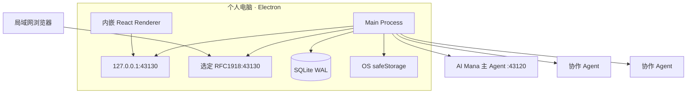
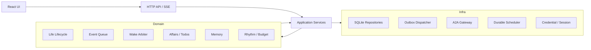
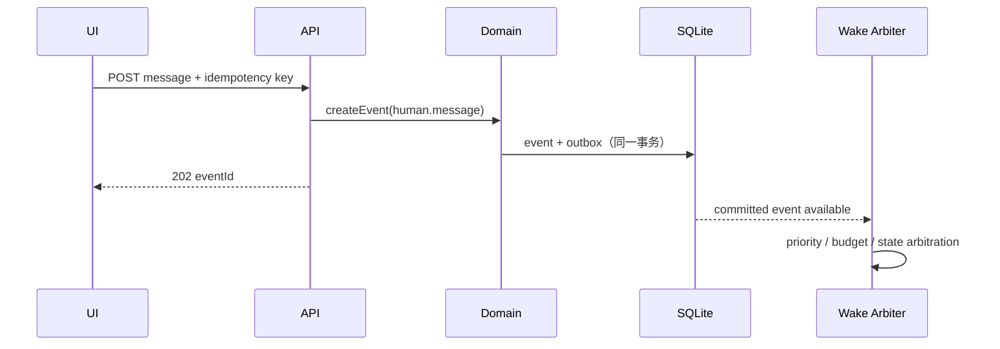

# 系统架构

## 0. JOI-01 目标架构

系统只有一个唯一全局 joi identity、system policy 与 scheduler，即唯一调度权威。Pi routing turn 只读取工作台摘要；选定后 execution turn 只装配对应工作台的 persona、工程引用、任务投影、记忆与相关搭档。不同工作台可拥有独立 thread 并并发工作，但不能拥有独立调度器。

```text
首页输入 -> durable joi inbox -> Pi routing -> Workbench context projection
         -> Work DAG -> policy gate -> outbox -> Local Pi / A2A Partner
         <- Workbench-scoped events <- result / failure / input / auth / artifact
```

分层保持不变：domain 为纯 TypeScript；application 编排 ports；infrastructure 实现 Pi、SQLite、safeStorage 与 A2A；interfaces 只映射 HTTP/SSE；renderer 只使用 shared DTO 和 `/api/v1`。Pi SDK 只能进入 `src/main/infrastructure/pi` 或 composition root。

Pi core 的 Skill 使用 SDK 原生渐进披露：`pi-sdk-skill-catalog.ts` 从允许的本机来源递归解析 frontmatter，并以稳定的 `source/relative-directory` 引用保存选择；派发时 `includeDefaults=false` 且只加载精确选中路径。搭档保存和设置列表复用同一个 exact validator，历史 revision 若已失效则以脱敏配置问题返回，设置页在修复前阻止提交。系统提示词仅含 SDK 生成的 `name/description/location` catalog，Skill 正文不预注入，由 Agent 使用 `read` 获取。`read` 的规范路径白名单为当前工作台加选中 Skill 根目录，其他绝对路径和符号链接逃逸均 fail closed。Skill 不会隐式增加工具；其 `metadata.joi_required_env` 只声明所需变量名，真正进入 bash 的敏感值还必须同时得到进程级 `JOI_PARTNER_ENV_PASSTHROUGH` 授权。Pi core 另外内置受控只读网页适配器，提供 `web_search`、`fetch_content`、`get_search_content`；它不动态加载任意第三方 Pi package，不读取 cookie/Authorization，不执行 clone 或写入 workspace，公开 URL、重定向、响应大小和缓存均有界。

本机 Pi 搭档没有整次 Work 或整个 Agent run 的固定总时限。运行时订阅 Pi Agent 的消息与工具生命周期事件；任一事件都刷新 20 分钟无进度截止，只有连续 20 分钟没有消息流、工具启动、工具更新或工具完成事件才 abort 当前 run，并形成稳定的 `partner_run_idle_timed_out`。每次独立工具调用另有不可放宽的 15 分钟上限，即使工具参数声明更长 timeout 也不能绕过；超时通过 AbortSignal 终止并以 `partner_tool_timed_out` 工具错误交回模型。该机制不改变副作用策略：已观察到副作用的 Work 仍不得自动重放。

### 0.1 搭档实例与工作记忆

搭档配置是无 cwd 的全局不可变模板；`PartnerInstanceManager` 负责运行中的工作台私有实例。每个实例必填 `workbenchId`，标记 `EPHEMERAL`（默认，单次即销毁）或 `RESIDENT`（保留会话、跨应用重启可恢复），确保、枚举、派发、复用和销毁都禁止跨工作台。实例行在 `partner_instances`，会话消息在 `partner_instance_messages`，`dispatch_attempts.instance_id` 关联派发。migration 027 会将升级前实例全部置为 `DISPOSED`；之后启动恢复只处理满足新不变量的实例。硬上限：常驻实例每工作台/搭档 4、全局 12、热 Agent 8。

搭档提示词正文继续经 `PartnerPromptStore` 与不可变 `promptRef` 隔离，普通 Partner DTO 只投影是否已配置。编辑页的显式 reveal 使用需要 session、Origin 与 CSRF 校验的写权限 POST，并返回 `Cache-Control: no-store`；正文不进入列表、诊断或日志。`REPLACE` 直接保存完整新正文，`APPEND` 在应用层读取当前活跃 revision 的正文、以空行连接追加内容后保存为新的 prompt row 与 Partner revision，缺失私有记录时 fail closed。

搭档工作记忆按 `(workbenchId, partnerId)` 存入 `workbench_partner_work_memories` 与 `workbench_partner_work_memory_summaries`：结果终态事实按 ground truth 追加，`session_data_source` 记录真实会话来源，滚动摘要按节拍刷新。内容不进入搭档自身提示词，也不由状态页或管理 API 返回；joi 只在当前工作台内读取选择所需的安全摘要。

joi 的结构化工具扩展为：`partner_create`（仅本机搭档，带 joi 创建标记）、工作台范围内 的 `partner_create_instance/list_instances/dispose_instance`、`partner_inspect_revision`、`model_list_sources`、`work_read_result`、`workbench_bind_workspace` 与 `user_ask`。`workbench_bind_workspace` 接受用户请求中明确给出的绝对目录并直接绑定当前 Workbench；未提供绝对目录时只持久化澄清，再由工作台卡片调用主进程目录选择器，返回安全元数据而不返回路径。多个 Workbench 可以绑定同一物理 root；各自仍保留 opaque workspace ref 与上下文隔离，READ/WRITE lease 通过私有 root 映射跨 ref 协调同目录冲突。`user_ask` 将一个具体阻塞问题持久化为结构化澄清，而不是仅输出不可恢复的普通文本。`work_dispatch` 只接收 `NONE | READ | WRITE`、互斥的 `instanceId/sessionPolicy`，不接收 workspace；文件工作自动使用工作台工作区。一次性 ephemeral Work 若误带实例引用，在计划提交前机械删除实例；一次自动纠正后仍需用户决定搭档时持久化 `partner_selection_required`。工作区未 READY 时整个计划在提交前失败，工具把输入转为 `workbench_workspace_not_ready` 澄清，避免留下无 attempt 的半成品计划。本机引擎通过 `WorkbenchExecutionContextReader` 私下解析 cwd，A2A 只得到脱敏快照且一律拒绝 READ/WRITE。旧 `GET /api/v1/system/pick-directory` 返回 410；目录选择仅发生在工作台工作区 bind 写接口内，`workbench_bind_workspace` 无路径时只创建澄清，响应不含路径。引擎多元化和 CLI 探测仍按 ADR 0004、0006、0007 执行。

每次派发前，`WorkbenchContextAssembler` 持久化只供执行链读取的安全快照。migration 034 起，所有 Work 必须强关联原始 `inputId`，且数据库同时校验 Turn、input 与工作台一致；每个 run 只有最早终态结果具有权威性，后续冲突仅保留审计事实。migration 035 把展示标题与私有 Work brief 分离，派发时按原始请求引用装配完整要求；声明了文件或精确字面的任务必须先通过受控 workspace verifier，Agent 报告的 `COMPLETED` 才能成为权威完成。结构化引擎输出先在单事务内落为 `WorkResult` 受限正文和不可变事实，再更新 Work 与工作台任务投影，最后追加 `work.result.recorded` 事件；提交后才由 workbench actor 的遍历发现并驱动 joi 综合（ADR 0009，SSE 通知已退役）。通知只带 resultId、终态和有界脱敏摘要，正文由 `work_read_result` 按当前工作台权限分页读取。`WAITING_INPUT`/`WAITING_AUTH` 保持 Work `WAITING` 并请求用户介入；不可可靠恢复的 `UNKNOWN` 是终态失败，Work 必须进入 `FAILED` 并继续目标级结果综合，不能伪装成“需要你”。migration 039 修复 schema 038 中已错误停留的 UNKNOWN Work、工作台活跃投影与尚未综合的结果成员。已取消 Work 的迟到结果保留 `is_late` 事实，但不重开工作、不自动进入 joi inbox。

### 0.2 场景预设与 joi 编排提示词

场景预设改在搭档页的"场景预设"页签呈现（不在首页铺陈），由 `GET /api/v1/scenarios` 提供。结构化澄清把 `clarification_reason_code` 与可选 `clarification_prompt` 经 record/DTO 透出；当原始输入已经给出绝对目录时，joi 工具先自动绑定工作台再恢复同一 `inputId`，否则目录卡才调用工作台工作区 bind，接口继续隐藏绝对路径。`partner_selection_required` 卡从既有 snapshot 过滤 ACTIVE、无 ACTION_REQUIRED 的搭档；点击经 `/clarify` 提交稳定 `partnerId`，应用层再次检查搭档状态并以 `expectedReasonCode` 原子守卫当前澄清，再追加有界结构化选择、恢复原输入。首页投影由 `GET /api/v1/joi/home-feed` 提供：原始输入按 goal 聚合为工作台卡，Turn 只投影 active `progressing` 与终态后 15 秒的低权重尾迹；`progressing` 同时投影由 SQLite 事实推导的阶段枚举、Agent 数、Work 计数和开始时间，renderer 只映射安全文案；合成结果输入不进入首页。尚未完成 Workbench 路由的 `PENDING` 原始输入也先以 `ARRANGING`/“等待归属”目标卡进入投影，绑定后沿同一 `inputId` 升级；未归属的结构化澄清仍只进入“需要你”列表，避免重复卡片。migration 036 以 goal result-set revision 聚合该目标的全部权威结果，只有所有 Work 终态后才调度隔离的最小工具综合 Turn；migration 043 为目标 outcome 增加 `COMPLETED/BLOCKED` disposition。综合 Turn 必须显式提交 `RESULT_SYNTHESIZED` 或 `RESULT_BLOCKED`，成功 disposition 至少要求一个已验收完成 Work；非关键失败只作为覆盖缺口和可下钻警告，不能覆盖足够证据形成的完成结论。migration 042 为 `DIRECT_ANSWER`/`TEAM_READY` 建立独立 `joi_turn_completions` 展示事实，由 Coordinator 捕获最终文本、在持久化前有界脱敏，并与 Turn/Inbox 完成置于同一事务；home-feed 只对已消费且无 result-set 的输入读取它，有当前 revision 的 Goal outcome 始终优先。综合期间卡片为 `FINALIZING` 并继续显示 progressing，当前 outcome 的 disposition 决定“已完成/处理失败”，Work 失败计数不再反向覆盖 outcome。运行诊断同时写 stderr 与 userData 下的有界滚动 JSONL，只接受 ID、状态、计数、安全原因码和耗时，绝不记录 completion 正文。

2026-08-26 起，上一段的“当前 outcome 决定终态”只适用于无 ACTIVE harness map 的兼容目标。Wayfinder goal 的 result outcome 是当前证据层总结：map ACTIVE 时 home-feed 必须投影 `REVIEWING`，review 派生 Work 活跃时投影 `EXTENDING`；只有 `MAP_CLEARED` 的存储事务验证最新综合水位、Work-path 覆盖、无活跃 Work 和无 OPEN path 后，当前 outcome 才晋升为首页最终结果并开放继续/删除。harness component 负责以 workId 幂等建立路径并由 Work 权威终态闭路。对历史 review 输入，组件先依据结果 disposition 和 Work/path 事实自动收敛：`COMPLETED` 且无活跃 Work、无 OPEN path、Work-path 完整时直接清理旧澄清标记，绝不重放历史 Turn；只有需要重新判断的 `BLOCKED`、缺行或证据不完整目标，才在 `side_effect_started=0` 时同 revision 幂等重排，否则转为有界 `NEEDS_ATTENTION`（`harness_review_unrecoverable`），不自动重放、不伪造完成。

Migration 033 建立独立的用户展示面：`workbench_agent_sessions` 将 post-033 本机 `partner_instances` 与 A2A `partner_runs` 映射为工作台 Agent 卡，不回填旧执行历史；`workbench_agent_conversation_entries` 保存规范化的 Markdown、工具、产物与错误条目。真实运行状态仍以原运行表为权威。未指定 goal 时 Agent 卡展示 instance availability；指定 `goalId` 时，查询在同一 session 下优先选择该 goal 的活跃 partner run，否则选择最新 partner run，并将其状态作为目标执行状态，不能让 resident instance 完成后回落的 IDLE 覆盖 COMPLETED/FAILED。执行适配器只提交安全展示草稿；pi-core 运行时把 `text_delta` 聚合为有界可见回答，把工具 lifecycle 降为工具名与完成/失败状态，并忽略 thinking、参数和原始工具结果。每个 live snapshot 经 `agent-conversation-presentation` 脱敏、分块后，在单个 SQLite 事务中按 `(agentId, runId)` 原位替换；终态完整投影再次替换同一 run，避免 token 级行膨胀和重复内容。该展示写入失败不改变 Work/run 结果。A2A data part 永不进入正文。删除一次性终态 Agent 只软删 session 并清理展示 entries，WorkResult、partner run、event 和审计事实保持。读取 API 为 `/api/v1/workbenches/:workbenchId/agents` 与其 `/conversation` 子资源。详见 ADR 0008。

现有 Life/Wake 链只作为迁移期兼容消费者。切换时必须 stop-old-before-start-new；shadow 比对不得写 outbox、派发或正式表达。

## 1. 架构目标

系统必须同时满足四个条件：桌面进程常驻、局域网浏览器可访问、生命状态可恢复、A2A Agents 可替换。架构因此采用“桌面 Runtime Hub + 同构 Web UI + 事件驱动内核”，而不是浏览器直连 Agents。

## 2. 技术基线

| 层             | 技术选择                                               |
| -------------- | ------------------------------------------------------ |
| 桌面壳与主进程 | Electron + Node.js + TypeScript                        |
| Web UI         | React + TypeScript + Vite                              |
| Hub API        | HTTP `/api/v1` + SSE                                   |
| 持久化         | SQLite、WAL、FTS5、显式迁移                            |
| A2A            | `@a2a-js/sdk`，协议 `0.3.x`                            |
| 凭据           | Electron `safeStorage`                                 |
| 密码派生       | Node `crypto.scrypt` + 独立随机 salt                   |
| 测试           | Vitest、React Testing Library、Playwright、临时 SQLite |

首版不引入外部消息队列、Redis、PostgreSQL、向量数据库或云服务。

## 3. 进程与部署拓扑



主进程创建两个独立监听器，共用同一 API handler：

- loopback listener 始终启用，保证桌面窗口可用。
- LAN listener 可选，只绑定用户明确选择的 RFC1918 地址。
- 禁止以 `0.0.0.0` 作为便捷回退；LAN 绑定失败不影响 loopback。

Android 原生远程是第三条独立边界（ADR 0013），不复用 LAN listener，也不把 `/api/v1` 暴露到公网。Electron 通过受控 sidecar 承载 iroh host；Android Rust FFI 控制端使用二维码中的 endpoint ticket 优先建立局域网直连，失败时走既有 iroh relay。sidecar 只按 connection id 转发有界不透明帧，不能调用 application service。主进程解密后由 `RemoteCommandService` 显式映射到 `home-feed` 读取和文字 inbox 提交，所有其他命令 fail closed。

Joi 使用独立 ALPN `/joi/remote/1` 和独立节点密钥，默认使用 `remote.joilab.top` 的标准 iroh relay；该域名与 `cudex.joilab.top` 可由同一 iroh 实例和多域名证书承载。原生链路不依赖 Cloudflare、DCDN、Node WebSocket 网关或新增 ECS 端口。

关闭窗口只隐藏到托盘；显式“退出 joi”才停止 Runtime。开机启动是用户可选设置。

## 4. 逻辑分层



### 4.1 Domain Runtime

纯领域层负责状态转换和决策规则，不直接访问 Electron、HTTP、SQLite 或 A2A SDK。核心组件：

- `LifeLifecycle`：启停、暂停、异常和预算状态。
- `EventQueue`：事件去重、优先级、消费和延迟。
- `WakeArbiter`：选择哪个生命、哪个事务和哪些事件可以运行。
- `ActionProcessor`：校验主 Agent动作并生成领域变更/outbox。
- `AffairService`：跨 Wake 事务、待办和等待关系。
- `MemoryService`：召回、残留和代谢提交。
- `RhythmService`：作息、闹钟、安静时段和预算。

### 4.2 Application Services

应用层编排用例和事务边界：创建生命、提交消息、开始 Wake、处理 A2A 流、回答 interaction、恢复任务、备份等。它是 API 与领域层之间唯一入口。

### 4.3 Infrastructure

- SQLite repositories：所有持久实体与迁移。
- Durable scheduler：只负责把到期规则写成事件，不直接调用 Agent。
- Actor tree（ADR 0009）：唯一根 tick 按 joi → workbench → agent 顺序遍历收敛；actor 无定时器、不互发消息，协调只经 SQLite 事实表；输入串行单槽位驱动推理 turn，partner 执行在 agent 层 ack 后运行、后续 tick 收敛终态，崩溃孤儿由启动首 tick 扫描收尾。失败的 turn 在收尾时中止其推理会话，残留流状态不得毒化同会话的后续 turn；同一输入连续即时失败超过上限（默认 8）即写入 migration 040 定义的独立失败事实并停摆，调度端口不具备用户取消能力。失败投影只公开有界原因码、尝试次数、是否已开始执行和枚举处理建议，杜绝 failTurn→重投 的崩溃环且不泄露原始异常。joi actor 还挂 harness component（ADR 0010）：遍历目标地图事实表（maps/paths/decisions/fog），为建图 goal 落图、把走完一层结果的 goal 以 review 系统输入排队进同一单槽位，由 joi 推理 turn 决定下一层路径或 MAP_CLEARED；组件自身不推理、不派发，唯一调度权威不变。
- A2A gateway：Card、Bearer、network policy、stream/get/cancel/resubscribe、Artifact。
- Connection breaker：按 Agent Connection/凭据版本共享 429/503 冷却，不阻塞事件持久化。
- Outbox dispatcher：事务提交后的外部调用；`partner.dispatch` 由 agent actor 领取交付（ADR 0009）。
- Credential store：safeStorage 加解密、管理员口令与会话。
- Diagnostics：结构化状态和脱敏日志。

### 4.4 Interface

- React 只使用 `/api/v1` 轮询，不读取数据库或 safeStorage。SSE 传输已退役（ADR 0009），renderer 按固定节奏轮询收敛；只有用户当前选中的 RUNNING/WAITING Agent 对话使用 750 ms 短轮询，终态立即停止，并以请求 revision 防止迟到响应覆盖新快照。
- Electron preload 只提供一次性桌面 bootstrap、窗口控制和本机文件选择，不复制业务 API。
- LAN 与桌面 UI 使用相同 DTO，避免双套行为。

### 4.5 可机器校验的边界

分层规则不仅写在文档中，还必须由 CI 的 import boundary test 强制执行：

- Interface 可以依赖 Application 与 shared DTO，不能直接依赖 Domain repository 或 A2A SDK。
- Application 可以依赖 Domain ports，不能实现 transport、SQL 或 Electron 生命周期。
- Domain 不能导入 Electron、HTTP、SQLite、文件系统或 A2A SDK。
- Infrastructure 实现 Domain/Application ports，不能反向定义事件优先级、Life 状态机或 action 规则。

规则使用明确的目录分类与允许依赖矩阵；新增未分类生产目录应使测试失败，而不是默认放行。

## 5. 持久化模型

SQLite 使用外键、唯一约束、事务和 WAL。至少包含以下逻辑表组：

| 表组     | 数据                                                                                                             |
| -------- | ---------------------------------------------------------------------------------------------------------------- |
| identity | lives、persona_versions、life_agent_bindings                                                                     |
| event    | life_events、event_links、wake_event_consumptions                                                                |
| runtime  | wakes、wake_turns、runtime_injections、life_actions、flow_events、outbox                                         |
| work     | affairs、todos、alarms、schedules                                                                                |
| memory   | consciousness_residues、memory_fragments、memory_cards、memory_entities、memory_links                            |
| agent    | agent_connections、agent_card_snapshots、agent_credentials、agent_contexts、invocations、interactions、artifacts |
| access   | admin_credentials、web_sessions、security_events                                                                 |
| ops      | schema_migrations、backup_history、runtime_leases                                                                |

重要约束：

- `life_events.dedupe_key` 在同一生命和事件类型内唯一。
- 每个 Life 最多一个未终止主 Wake。
- `messageId`、`invocationId`、远端 `taskId/contextId` 分开存储。
- action 使用 `(wake_id, action_id)` 去重。
- runtime injection 单独引用 event/memory/result，不伪装成 user/agent message。
- flow event 在同一 run 内使用单调 sequence，并保留 parent/causation/correlation 关系。
- 所有外部副作用先写 outbox；dispatcher 领取后才执行。
- Bearer 原文不进入业务表，只保存 safeStorage blob 与凭据 id。

### 5.1 运行审计模型

审计必须区分四类事实：

| 类型      | 记录内容                                                                        |
| --------- | ------------------------------------------------------------------------------- |
| Wake      | 选中的事件批次、persona version、开始/结束原因、lease 与最终状态                |
| WakeTurn  | 实际 A2A 调用、messageId/taskId/contextId、流状态、首包/末包和 `lastActivityAt` |
| Injection | 在某个 Turn 前加入的事件、记忆和系统结果引用，以及被 Agent 读取的时间           |
| FlowEvent | ingress → domain → orchestration → execution → feedback 的状态转换和因果链      |

FlowEvent 不替代领域表，也不默认保存正文。每个 `ActionDispatched` 必须最终关联 Observation、ToolError 或 ExecutionFailed。Turn 序号生成应跨部分失败保持单调，避免审计写入中断后复用序号。

## 6. 核心数据流

### 6.1 用户消息



API 返回 202 只表示事件已经持久化，不表示 Agent 已阅读或回复。

### 6.2 主 Agent Wake

1. Arbiter 在事务中为 Life 取得运行 lease，并创建 Wake。
2. Context assembler读取事件、人格版本、残留、事务、召回记忆和预算。
3. Context assembler 将本 Turn 新增内容登记为 Injection，并引用原 eventId/memoryId。
4. A2A gateway 使用稳定 messageId 发送 `WakeEnvelope`。
5. 流式状态进入 Invocation/FlowEvent 记录；正式动作只从终态输出解析。
6. `ActionProcessor` 校验完整 Envelope，将本地变更与 outbox 原子提交。
7. 表达推送 UI；委派进入 outbox；事件在动作提交后标为已消费。
8. Wake 继续有限 Turn 或写残留并进入休眠。

### 6.3 协作者

协作调用不持有主 Wake：

1. `delegate` 动作创建 Affair 子工作和 Invocation outbox。
2. Dispatcher 在并发额度内调用协作者。
3. 结果、失败、input/auth 或 Artifact 被标准化为事件。
4. 主 Agent 在新 Wake 中处理这些事件。

这样 Agent 慢、离线或等待用户时不会占住数字生命的唯一运行线程。

## 7. API 与 SSE 边界

### 7.1 REST 资源

首版稳定资源：

```text
/api/v1/auth/*
/api/v1/lives
/api/v1/lives/{lifeId}/events
/api/v1/lives/{lifeId}/messages
/api/v1/lives/{lifeId}/runtime/*
/api/v1/lives/{lifeId}/affairs
/api/v1/lives/{lifeId}/todos
/api/v1/lives/{lifeId}/alarms
/api/v1/lives/{lifeId}/schedules
/api/v1/lives/{lifeId}/memories
/api/v1/agents
/api/v1/scenario-packs
/api/v1/scenario-packs/{packId}/install
/api/v1/interactions
/api/v1/artifacts
/api/v1/backups
/api/v1/diagnostics
```

所有创建型写请求接受 `Idempotency-Key`。列表使用 opaque cursor；错误统一为 `{ code, message, requestId, details? }`，`details` 不包含敏感信息。

场景预设包安装在 application 层按稳定 `(packId, roleId)` 编排 Partner registry，在 infrastructure 层持久化绑定。内置定义只保存经过移植的角色职责和安全工具引用，不在运行时读取来源 checkout；重新安装只补齐缺失角色，并保留用户对既有 Partner revision 的修改。

### 7.2 SSE（已退役，见 ADR 0009）

> ADR 0009 起 SSE 传输退役：`/api/v1/stream` 端点删除，`sse_events` 投影冻结（表保留不重建），renderer 纯轮询。下述内容仅作历史边界记录。

`GET /api/v1/stream?cursor=<opaque>` 推送用户有权看到的增量：

- `life.state.changed`
- `event.created/consumed`
- `wake.changed`
- `expression.created`
- `invocation.changed`
- `interaction.created/resolved`
- `artifact.created`
- `budget.changed`

每条包含单调递增序号。客户端用 `Last-Event-ID` 恢复；服务端至少保留最近 7 天 SSE 投影，超出则返回 `stream_reset` 并要求刷新资源快照。

## 8. 鉴权与信任边界

- 桌面 renderer 通过 preload 取得一次性 bootstrap nonce，换取 HttpOnly 本地会话；nonce 不写 URL、日志或 localStorage。
- LAN 浏览器使用管理员口令登录，获得 HttpOnly、SameSite=Strict 会话 Cookie。
- LAN 使用可信私网 HTTP，MVP 不提供 TLS；UI 必须明确风险，不允许公网地址。
- CSRF 防护使用 SameSite Cookie + 每会话 CSRF token；所有写请求校验 Origin 与 token。
- A2A Bearer 只在主进程内解密并发送，绝不下发浏览器。
- iroh 节点私钥只在主进程内解密并通过 sidecar stdin 传递；Android App 永远不取得桌面 Cookie、CSRF 或 `/api/v1` 访问权。
- Android 远程设备使用独立端到端设备密钥和每连接会话密钥；中继只看见连接元数据和不透明帧。二维码不经过 HTTP 服务。
- 配套 joi 扩展提供受信任运行时指令；事件正文、记忆和协作者结果仍按不可信数据处理。

## 9. 并发与租约

- 单 Life：最多 1 个主 Wake。
- Hub：默认最多 4 个同时 A2A Invocation。
- 单 Endpoint：最多 2 个 Invocation。
- 同一 `Agent Connection + credentialVersion` 共享 429/503 breaker；冷却只阻止新 Invocation，不丢弃事件。
- 单 Life：协作者并行最多 4 个。
- SQLite `runtime_lease` 带 owner、generation、expiresAt；只有持有者可推进 Wake。
- 主进程单实例锁防止两个 Hub 同时打开同一数据库。

## 10. 崩溃与重启恢复

启动顺序固定为：

1. 取得单实例锁，打开数据库并完成迁移。
2. 以进程内运行标记、持久 Turn `lastActivityAt` 和 Wake 启动宽限共同校验过期 lease、未完成 Wake 和 Invocation；不得使用 Affair 普通更新时间代替心跳。
3. 对已知远端 taskId 执行 `getTask`，工作中则 `resubscribeTask`。
4. 对已发送但未获 taskId 的请求，仅以原 messageId 重试一次。
5. 无法确认的调用进入 `UNKNOWN_REQUIRES_REVIEW`，不得盲目新建任务。
6. 恢复未消费事件和到期 scheduler 规则。
7. 启动 loopback，再尝试 LAN listener，最后允许 Arbiter 调度。

显式退出先停止新 Wake，给正在提交事务的动作短暂排空时间，再取消或持久化剩余远端调用状态。

## 11. 打包与数据目录

- 生产包包含 Electron main/preload/renderer、SQLite migration 和协议 schema。
- 用户数据位于 Electron `userData` 下的版本化目录。
- Artifact 与备份位于独立受控目录，数据库只保存相对路径和 hash。
- 开发环境、测试环境和生产环境使用不同数据根，禁止共享真实凭据。
- 文档阶段不创建上述目录或实现文件。

## 12. 架构约束

- Renderer 不得直接使用 A2A SDK、SQLite、Node fs 或 safeStorage。
- Scheduler 不得直接调用 Agent，必须生成事件。
- A2A stream 不得直接修改 Life；必须先标准化为 Invocation 结果或事件。
- Agent 自然语言不得直接执行数据库写入；只有通过 schema 校验的 action 生效。
- contextId 过期不得导致 Life、Affair、Memory 或 Event 删除。
- LAN listener 失败不得使桌面端不可用。
- 到期 Alarm 只有在对应 event/outbox 已持久化后才能标记 FIRED；投递失败必须保持可重试。
- 默认采用单主进程与 per-Life lease；每 Life worker process 只能在长稳证据和 ADR 支持下作为后续隔离模式引入。

## 13. 工作聚类与能力搭档命名

- 工作台名称、范围和工程标签描述持久的工作聚类与运行环境，不描述某一个 Agent 的人格或职位；前端调试/分析工作自动使用受管环境目录 `aimanadebug`。
- Agent/Partner 名称描述可复用的能力聚类，例如 `编码工坊`；能力描述只写职责边界，不重复工作台环境、目录或项目上下文。
- 工作台创建、受管目录重建和目录 provision 共用同一命名规则。目录名只作为受控路径的最后一段，绝对路径仍只留在主进程基础设施。
