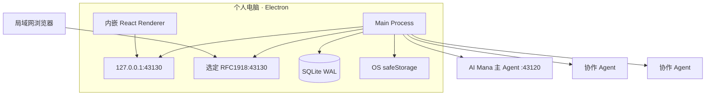
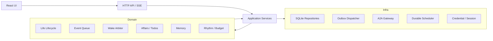
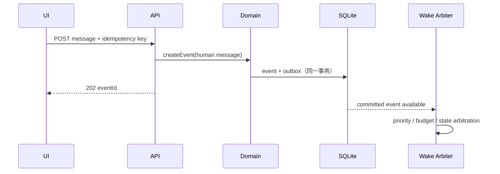

# 系统架构

## 0. JOI-01 目标架构

系统只有一个唯一全局 joi identity、system policy 与 scheduler，即唯一调度权威。Pi routing turn 只读取 Avatar 摘要；选定后 execution turn 只装配对应 Avatar 的 persona、工程引用、任务投影、记忆与相关搭档。不同 Avatar 可拥有独立 thread 并并发工作，但不能拥有独立调度器。

```text
首页输入 -> durable joi inbox -> Pi routing -> Avatar context projection
         -> Work DAG -> policy gate -> outbox -> Local Pi / A2A Partner
         <- Avatar-scoped events <- result / failure / input / auth / artifact
```

分层保持不变：domain 为纯 TypeScript；application 编排 ports；infrastructure 实现 Pi、SQLite、safeStorage 与 A2A；interfaces 只映射 HTTP/SSE；renderer 只使用 shared DTO 和 `/api/v1`。Pi SDK 只能进入 `src/main/infrastructure/pi` 或 composition root。

现有 Life/Wake 链只作为迁移期兼容消费者。切换时必须 stop-old-before-start-new；shadow 比对不得写 outbox、派发或正式表达。

## 1. 架构目标

系统必须同时满足四个条件：桌面进程常驻、局域网浏览器可访问、生命状态可恢复、A2A Agents 可替换。架构因此采用“桌面 Runtime Hub + 同构 Web UI + 事件驱动内核”，而不是浏览器直连 Agents。

## 2. 技术基线

| 层             | 技术选择                                               |
| -------------- | ------------------------------------------------------ |
| 桌面壳与主进程 | Electron + Node.js + TypeScript                        |
| Web UI         | React + TypeScript + Vite                              |
| Hub API        | HTTP `/api/v1` + SSE                                   |
| 持久化         | SQLite、WAL、FTS5、显式迁移                            |
| A2A            | `@a2a-js/sdk`，协议 `0.3.x`                            |
| 凭据           | Electron `safeStorage`                                 |
| 密码派生       | Node `crypto.scrypt` + 独立随机 salt                   |
| 测试           | Vitest、React Testing Library、Playwright、临时 SQLite |

首版不引入外部消息队列、Redis、PostgreSQL、向量数据库或云服务。

## 3. 进程与部署拓扑



主进程创建两个独立监听器，共用同一 API handler：

- loopback listener 始终启用，保证桌面窗口可用。
- LAN listener 可选，只绑定用户明确选择的 RFC1918 地址。
- 禁止以 `0.0.0.0` 作为便捷回退；LAN 绑定失败不影响 loopback。

关闭窗口只隐藏到托盘；显式“退出 joi”才停止 Runtime。开机启动是用户可选设置。

## 4. 逻辑分层



### 4.1 Domain Runtime

纯领域层负责状态转换和决策规则，不直接访问 Electron、HTTP、SQLite 或 A2A SDK。核心组件：

- `LifeLifecycle`：启停、暂停、异常和预算状态。
- `EventQueue`：事件去重、优先级、消费和延迟。
- `WakeArbiter`：选择哪个生命、哪个事务和哪些事件可以运行。
- `ActionProcessor`：校验主 Agent动作并生成领域变更/outbox。
- `AffairService`：跨 Wake 事务、待办和等待关系。
- `MemoryService`：召回、残留和代谢提交。
- `RhythmService`：作息、闹钟、安静时段和预算。

### 4.2 Application Services

应用层编排用例和事务边界：创建生命、提交消息、开始 Wake、处理 A2A 流、回答 interaction、恢复任务、备份等。它是 API 与领域层之间唯一入口。

### 4.3 Infrastructure

- SQLite repositories：所有持久实体与迁移。
- Durable scheduler：只负责把到期规则写成事件，不直接调用 Agent。
- A2A gateway：Card、Bearer、network policy、stream/get/cancel/resubscribe、Artifact。
- Connection breaker：按 Agent Connection/凭据版本共享 429/503 冷却，不阻塞事件持久化。
- Outbox dispatcher：事务提交后的外部调用与 SSE 发布。
- Credential store：safeStorage 加解密、管理员口令与会话。
- Diagnostics：结构化状态和脱敏日志。

### 4.4 Interface

- React 只使用 `/api/v1` 和 `/api/v1/stream`，不读取数据库或 safeStorage。
- Electron preload 只提供一次性桌面 bootstrap、窗口控制和本机文件选择，不复制业务 API。
- LAN 与桌面 UI 使用相同 DTO，避免双套行为。

### 4.5 可机器校验的边界

分层规则不仅写在文档中，还必须由 CI 的 import boundary test 强制执行：

- Interface 可以依赖 Application 与 shared DTO，不能直接依赖 Domain repository 或 A2A SDK。
- Application 可以依赖 Domain ports，不能实现 transport、SQL 或 Electron 生命周期。
- Domain 不能导入 Electron、HTTP、SQLite、文件系统或 A2A SDK。
- Infrastructure 实现 Domain/Application ports，不能反向定义事件优先级、Life 状态机或 action 规则。

规则使用明确的目录分类与允许依赖矩阵；新增未分类生产目录应使测试失败，而不是默认放行。

## 5. 持久化模型

SQLite 使用外键、唯一约束、事务和 WAL。至少包含以下逻辑表组：

| 表组     | 数据                                                                                                             |
| -------- | ---------------------------------------------------------------------------------------------------------------- |
| identity | lives、persona_versions、life_agent_bindings                                                                     |
| event    | life_events、event_links、wake_event_consumptions                                                                |
| runtime  | wakes、wake_turns、runtime_injections、life_actions、flow_events、outbox                                         |
| work     | affairs、todos、alarms、schedules                                                                                |
| memory   | consciousness_residues、memory_fragments、memory_cards、memory_entities、memory_links                            |
| agent    | agent_connections、agent_card_snapshots、agent_credentials、agent_contexts、invocations、interactions、artifacts |
| access   | admin_credentials、web_sessions、security_events                                                                 |
| ops      | schema_migrations、backup_history、runtime_leases                                                                |

重要约束：

- `life_events.dedupe_key` 在同一生命和事件类型内唯一。
- 每个 Life 最多一个未终止主 Wake。
- `messageId`、`invocationId`、远端 `taskId/contextId` 分开存储。
- action 使用 `(wake_id, action_id)` 去重。
- runtime injection 单独引用 event/memory/result，不伪装成 user/agent message。
- flow event 在同一 run 内使用单调 sequence，并保留 parent/causation/correlation 关系。
- 所有外部副作用先写 outbox；dispatcher 领取后才执行。
- Bearer 原文不进入业务表，只保存 safeStorage blob 与凭据 id。

### 5.1 运行审计模型

审计必须区分四类事实：

| 类型      | 记录内容                                                                        |
| --------- | ------------------------------------------------------------------------------- |
| Wake      | 选中的事件批次、persona version、开始/结束原因、lease 与最终状态                |
| WakeTurn  | 实际 A2A 调用、messageId/taskId/contextId、流状态、首包/末包和 `lastActivityAt` |
| Injection | 在某个 Turn 前加入的事件、记忆和系统结果引用，以及被 Agent 读取的时间           |
| FlowEvent | ingress → domain → orchestration → execution → feedback 的状态转换和因果链      |

FlowEvent 不替代领域表，也不默认保存正文。每个 `ActionDispatched` 必须最终关联 Observation、ToolError 或 ExecutionFailed。Turn 序号生成应跨部分失败保持单调，避免审计写入中断后复用序号。

## 6. 核心数据流

### 6.1 用户消息



API 返回 202 只表示事件已经持久化，不表示 Agent 已阅读或回复。

### 6.2 主 Agent Wake

1. Arbiter 在事务中为 Life 取得运行 lease，并创建 Wake。
2. Context assembler读取事件、人格版本、残留、事务、召回记忆和预算。
3. Context assembler 将本 Turn 新增内容登记为 Injection，并引用原 eventId/memoryId。
4. A2A gateway 使用稳定 messageId 发送 `WakeEnvelope`。
5. 流式状态进入 Invocation/FlowEvent 记录；正式动作只从终态输出解析。
6. `ActionProcessor` 校验完整 Envelope，将本地变更与 outbox 原子提交。
7. 表达推送 UI；委派进入 outbox；事件在动作提交后标为已消费。
8. Wake 继续有限 Turn 或写残留并进入休眠。

### 6.3 协作者

协作调用不持有主 Wake：

1. `delegate` 动作创建 Affair 子工作和 Invocation outbox。
2. Dispatcher 在并发额度内调用协作者。
3. 结果、失败、input/auth 或 Artifact 被标准化为事件。
4. 主 Agent 在新 Wake 中处理这些事件。

这样 Agent 慢、离线或等待用户时不会占住数字生命的唯一运行线程。

## 7. API 与 SSE 边界

### 7.1 REST 资源

首版稳定资源：

```text
/api/v1/auth/*
/api/v1/lives
/api/v1/lives/{lifeId}/events
/api/v1/lives/{lifeId}/messages
/api/v1/lives/{lifeId}/runtime/*
/api/v1/lives/{lifeId}/affairs
/api/v1/lives/{lifeId}/todos
/api/v1/lives/{lifeId}/alarms
/api/v1/lives/{lifeId}/schedules
/api/v1/lives/{lifeId}/memories
/api/v1/agents
/api/v1/interactions
/api/v1/artifacts
/api/v1/backups
/api/v1/diagnostics
```

所有创建型写请求接受 `Idempotency-Key`。列表使用 opaque cursor；错误统一为 `{ code, message, requestId, details? }`，`details` 不包含敏感信息。

### 7.2 SSE

`GET /api/v1/stream?cursor=<opaque>` 推送用户有权看到的增量：

- `life.state.changed`
- `event.created/consumed`
- `wake.changed`
- `expression.created`
- `invocation.changed`
- `interaction.created/resolved`
- `artifact.created`
- `budget.changed`

每条包含单调递增序号。客户端用 `Last-Event-ID` 恢复；服务端至少保留最近 7 天 SSE 投影，超出则返回 `stream_reset` 并要求刷新资源快照。

## 8. 鉴权与信任边界

- 桌面 renderer 通过 preload 取得一次性 bootstrap nonce，换取 HttpOnly 本地会话；nonce 不写 URL、日志或 localStorage。
- LAN 浏览器使用管理员口令登录，获得 HttpOnly、SameSite=Strict 会话 Cookie。
- LAN 使用可信私网 HTTP，MVP 不提供 TLS；UI 必须明确风险，不允许公网地址。
- CSRF 防护使用 SameSite Cookie + 每会话 CSRF token；所有写请求校验 Origin 与 token。
- A2A Bearer 只在主进程内解密并发送，绝不下发浏览器。
- 配套 joi 扩展提供受信任运行时指令；事件正文、记忆和协作者结果仍按不可信数据处理。

## 9. 并发与租约

- 单 Life：最多 1 个主 Wake。
- Hub：默认最多 4 个同时 A2A Invocation。
- 单 Endpoint：最多 2 个 Invocation。
- 同一 `Agent Connection + credentialVersion` 共享 429/503 breaker；冷却只阻止新 Invocation，不丢弃事件。
- 单 Life：协作者并行最多 4 个。
- SQLite `runtime_lease` 带 owner、generation、expiresAt；只有持有者可推进 Wake。
- 主进程单实例锁防止两个 Hub 同时打开同一数据库。

## 10. 崩溃与重启恢复

启动顺序固定为：

1. 取得单实例锁，打开数据库并完成迁移。
2. 以进程内运行标记、持久 Turn `lastActivityAt` 和 Wake 启动宽限共同校验过期 lease、未完成 Wake 和 Invocation；不得使用 Affair 普通更新时间代替心跳。
3. 对已知远端 taskId 执行 `getTask`，工作中则 `resubscribeTask`。
4. 对已发送但未获 taskId 的请求，仅以原 messageId 重试一次。
5. 无法确认的调用进入 `UNKNOWN_REQUIRES_REVIEW`，不得盲目新建任务。
6. 恢复未消费事件和到期 scheduler 规则。
7. 启动 loopback，再尝试 LAN listener，最后允许 Arbiter 调度。

显式退出先停止新 Wake，给正在提交事务的动作短暂排空时间，再取消或持久化剩余远端调用状态。

## 11. 打包与数据目录

- 生产包包含 Electron main/preload/renderer、SQLite migration 和协议 schema。
- 用户数据位于 Electron `userData` 下的版本化目录。
- Artifact 与备份位于独立受控目录，数据库只保存相对路径和 hash。
- 开发环境、测试环境和生产环境使用不同数据根，禁止共享真实凭据。
- 文档阶段不创建上述目录或实现文件。

## 12. 架构约束

- Renderer 不得直接使用 A2A SDK、SQLite、Node fs 或 safeStorage。
- Scheduler 不得直接调用 Agent，必须生成事件。
- A2A stream 不得直接修改 Life；必须先标准化为 Invocation 结果或事件。
- Agent 自然语言不得直接执行数据库写入；只有通过 schema 校验的 action 生效。
- contextId 过期不得导致 Life、Affair、Memory 或 Event 删除。
- LAN listener 失败不得使桌面端不可用。
- 到期 Alarm 只有在对应 event/outbox 已持久化后才能标记 FIRED；投递失败必须保持可重试。
- 默认采用单主进程与 per-Life lease；每 Life worker process 只能在长稳证据和 ADR 支持下作为后续隔离模式引入。
