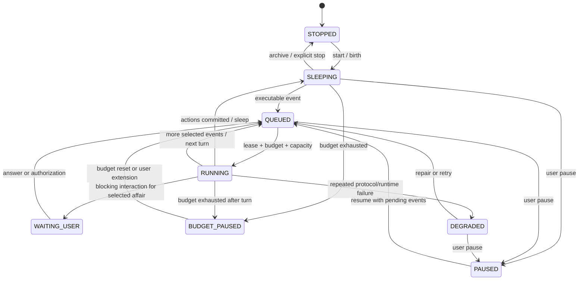

# 领域模型与运行时

## 0. JOI-01 Avatar 与工作运行时

唯一全局 joi 负责决策，Avatar 负责上下文，Partner 负责执行，Work 负责生命周期。Avatar 不是 Agent，也不是 scheduler。

`Avatar` aggregate 仅直接拥有 `AvatarProfile`、`AvatarProjectContext`、`AvatarMemoryNamespace` 与 `AvatarTaskContext`。budget、schedule、rhythm、partner policy、Pi thread 和 work execution 都是按 `avatarId` 关联的独立事实。任何 work item 必须恰好绑定一个 `avatarId`；跨 Avatar 检索和操作默认拒绝。

输入先写全局 inbox，再由 Pi 选择 `select | create | suggest_merge | suggest_archive | clarify`。非法结构化决策只修复一次；再次失败进入澄清或安全串行降级。merge/archive 只生成建议，必须经用户确认。

Partner 配置（revision）是模板；运行中的 `PartnerInstance` 分为 `EPHEMERAL`（单次派发后销毁、消息清除）与 `RESIDENT`（会话消息持久化、跨重启恢复、目标完成后由 joi 销毁）。一个 Partner 可同时存在多个实例；实例不跨 Partner，忙碌实例不可复用也不可销毁。每个 Partner 有一份仅 joi 可见的工作记忆：结果、会话真实数据源与滚动摘要，对 Partner 自身提示词不可见，只作为 joi 选择与复用实例的依据。

下文 Life/Wake 状态机继续定义旧数据兼容和恢复不变量；新运行时不得把它复制为第二条可产生副作用的调度链。

## 1. 运行时不变量

1. Life 的连续性由本地持久状态建立，不由任何单个 A2A context 建立。
2. 任何外部刺激在成为 `LifeEvent` 之前都不能唤醒主 Agent。
3. 一个 Life 同时只有一个主 Wake，但可以有多个异步协作者 Invocation。
4. Agent 只能提出动作；Hub 校验、持久化并执行动作。
5. 事件只有在对应动作事务成功后才算消费。
6. 远端结果未知时不能推断为完成，也不能创建新的副作用调用。
7. “Wake 正在运行”必须有进程标记、持久 Turn 心跳或启动宽限证据，不能从普通业务更新时间推断。
8. 到期 Alarm 只有在对应事件或 outbox 已持久化后才能进入 FIRED。

## 2. 聚合与实体

### 2.1 Life

Life 是聚合根，包含：

- 稳定 `lifeId`、名称、头像、角色、时区。
- 当前 persona version 与原则。
- 主 Agent binding、协作者 allowlist。
- lifecycle state、暂停原因、创建/归档时间。
- 作息、预算、安静时段和空闲探索设置。
- 当前意识残留、下一已知唤醒时间和今日用量。

Persona 修改创建新版本。已经完成的 Wake 永远引用当时版本，避免历史被改写。

### 2.2 LifeEvent

事件的最小字段：

```ts
type LifeEvent = {
  eventId: string;
  lifeId: string;
  type: LifeEventType;
  source: "human" | "runtime" | "schedule" | "agent" | "system";
  priority: 0 | 1 | 2 | 3;
  occurredAt: string;
  availableAt: string;
  dedupeKey?: string;
  affairId?: string;
  payload: Record<string, unknown>;
  attemptCount: number;
  claimedByWakeId?: string;
  status: "PENDING" | "CLAIMED" | "CONSUMED" | "DEFERRED" | "DEAD_LETTER";
};
```

优先级：

|  值 | 类型 | 示例                                      |
| --: | ---- | ----------------------------------------- |
|   0 | 紧急 | auth、恢复冲突、用户紧急停止后的确认      |
|   1 | 直接 | 用户消息、input 回答、关键 Agent 结果     |
|   2 | 计划 | 闹钟、待办到期、早晚作息、普通 Agent 结果 |
|   3 | 后台 | 记忆整理、健康检查、空闲探索              |

同优先级按 `availableAt, occurredAt, eventId` 排序。

### 2.3 Wake 与 WakeTurn

- Wake 是一次从事件选择到休眠的领域周期。
- WakeTurn 是 Wake 内的一次主 Agent A2A 调用。
- 每个 Wake 最多 4 个主 Agent Turn，避免单次循环失控。
- 每次 Turn 都必须有独立稳定 messageId；重试复用原 id。
- 一个 Wake 可以因委派、等待未来时间或预算主动结束，而不等于事务完成。
- WakeTurn 只记录真实 A2A 调用；运行期间追加的事件/记忆/结果登记为 Injection，并引用其来源 id。
- Wake、Turn 和 Injection 共享可重建的顺序，但 Injection 不伪装成用户或 Agent 消息。

### 2.4 Affair 与 Todo

Affair 是跨 Wake 的主线：

```text
OPEN → RUNNING → WAITING → RUNNING → DONE
                  ├──────────────→ FAILED
                  └──────────────→ CANCELED
```

`WAITING` 必须声明等待原因：`HUMAN_INPUT`、`AUTH`、`AGENT_RESULT`、`TIME` 或 `BUDGET`。一个等待中的 Affair 不阻塞其他 Affair。

Todo 属于 Affair 或 Life 全局，状态为 `OPEN | IN_PROGRESS | DONE | CANCELED`。Todo 到期只产生事件，Hub 不擅自判定下一步。

### 2.5 AgentContext 与 Invocation

- 主 Agent context 按 Affair 维护；没有 Affair 的生命活动使用保留的 `system` Affair。
- 协作者 context 按 delegation 维护，不与主 Agent共享。
- 一个 auth/input 暂停只阻塞对应 context 与 Affair。
- context 过期时生成新的 context，并注入有界交接包。
- Invocation 保存本地 id、Agent、messageId、远端 taskId/contextId、状态、重试和结果摘要。

## 3. Life 状态机



`WAITING_USER` 表示当前选中事务需要用户；如果其他事务存在可执行高优先级事件，Arbiter 可以为它们创建新 Wake，Life 页面同时展示等待卡。

## 4. 事件类型

MVP 事件类型固定如下：

```text
system.birth
system.recovery
system.agent_unavailable
human.message
human.input_answered
human.auth_resolved
schedule.morning_plan
schedule.evening_review
schedule.memory_metabolism
alarm.fired
todo.due
todo.reminder
agent.completed
agent.failed
agent.input_required
agent.auth_required
agent.artifact_created
budget.reset
budget.exhausted
idle.explore
memory.corrected
```

未知扩展事件可以保存，但在 schema 注册前不得自动唤醒主 Agent。

### 4.1 EventTypeRegistry

所有可自动唤醒的事件必须在单一、版本化的 EventTypeRegistry 注册：

```ts
type EventTypeDefinition = {
  type: string;
  payloadSchema: string;
  defaultPriority: 0 | 1 | 2 | 3;
  autoWake: boolean;
  debounce?: { windowMs: number; merge: "latest" | "accumulate" | "count" };
  contextPolicy: string;
  maxAttempts: number;
};
```

注册表是 schema、默认优先级、合并策略、context policy 和重试上限的唯一事实源；UI 只消费可展示投影，不在页面中复制运行规则。带未来 `availableAt` 的事件不参与即时去抖。事件类型未知或 payload 无效时可以进入隔离/诊断状态，但不得自动装配进受信任 Wake。

## 5. 唤醒算法

### 5.1 仲裁

Arbiter 对每个 Life 执行：

1. 跳过 `STOPPED`、`PAUSED` 或已有主 Wake 的 Life。
2. 查询 `availableAt <= now` 的 PENDING 事件。
3. 选择最高优先级且未被安静时段/预算延迟的 Affair。
4. 以同 Affair 为主批次，再附带对当前决策有意义的 Life 全局事件。
5. 最多 50 个事件、64 KiB；用户消息不合并，重复健康/预算事件可按 dedupeKey 合并。
6. 事务内把事件标为 CLAIMED、创建 Wake 并取得 lease。
7. 没有 A2A 容量时保持 QUEUED，不反复创建 Wake。

### 5.2 上下文组装

`WakeEnvelope` 的本地来源顺序：

1. 生命 id、persona version、原则和当前角色。
2. 本次事件批次及来源边界。
3. 当前 Affair、Todo、等待关系和最近结果。
4. 上一个意识残留。
5. 通过 FTS/实体/事务召回的相关记忆，最多 16 条、32 KiB。
6. 今日预算、安静时段、当前时间与下一固定作息。
7. 可调用协作者的稳定 id、公开技能和当前健康。

总 Envelope 目标上限 128 KiB；超过时依次裁剪低置信记忆、较老背景事件和非必要 Agent 描述，不裁剪当前用户消息或 auth/input 绑定。

### 5.3 Turn 与收工

主 Agent 返回动作后：

1. 校验 extension URI、version、wakeId、actionId 和动作 schema。
2. 检查动作引用的 Affair、Todo、Alarm、Agent 和 interaction 是否属于当前 Life。
3. 对相同 `(wakeId, actionId)` 返回既有处理结果。
4. 在一个事务中写动作、领域变更、意识残留、事件消费和 outbox。
5. 若动作要求继续当前 Wake 且 Turn 未超限，装配新 Turn。
6. 否则释放 lease，Life 回到 SLEEPING/WAITING/BUDGET_PAUSED。

动作 Envelope 无效时，允许一次 repair Turn，只发送 schema 错误和原 Envelope hash。第二次仍失败则：

- Wake 进入 `FAILED_PROTOCOL`。
- CLAIMED 事件回到 PENDING，并增加失败计数。
- 自动创建 10 分钟后的低优先级 `system.recovery`。
- 连续 3 次协议失败后 Life 进入 `DEGRADED`，等待用户处理。

### 5.4 运行中到达的新事件

新事件在某个 Wake/Turn 运行时到达，遵循“持久事实 + 轻量信号”语义：

1. API 先提交 `LifeEvent`，立即向 UI 返回 eventId。
2. 若当前主 Agent 能在下一 Turn 接收上下文，只向运行循环发送 eventId/queue-dirty 信号，不复制正文。
3. 当前 A2A stream 不被取消，也不把消息伪造成当前 session 的另一条 user message。
4. Context assembler 在下一 Turn 前重新查询 PENDING 事件，过滤已经被其他恢复路径消费的 id，并登记 Injection。
5. 只有包含该 eventId 的动作事务成功后才标记 CONSUMED。
6. 若 Wake 在拾取信号前休眠或崩溃，事件保持 PENDING，由下一 Wake 读取。

事件来源、channel/thread/context 和关联 Affair 必须保留在 Injection 引用中。UI 的“已发送”“Agent 已读取”“已回复”是三个不同事实，不能用流式状态猜测。

### 5.5 Wake liveness

`WakeLiveness` 使用统一配置和以下证据：

1. 当前进程持有该 wakeId 的 in-process running marker。
2. 最新 WakeTurn 的 `lastActivityAt` 未超过 stale threshold。
3. Wake 刚创建且还没有首个 Turn，仍在 startup grace 内。

只有三者都不成立才允许恢复器把 Wake 判定为 stale。Arbiter、scheduler、启动恢复和诊断必须调用同一个服务；MVP 可从 30 分钟 stale threshold 起步，但发布前必须用真实长任务数据校准。

### 5.6 事件失败退避

事件批次处理失败后仍保留原 eventId，只增加 attemptCount、错误码并把 `availableAt` 推后。初始候选为 `2/4/8/16/32/60` 分钟，上限 60 分钟；达到 EventTypeRegistry 的 maxAttempts 后进入 DEAD_LETTER 并生成一次诊断通知。

失败事件不得通过新建 Alarm 重试。Alarm 只表示真实未来意图；同一事件批次的成员保持同步 availableAt，避免一次 Wake 的因果上下文被拆散。

## 6. 生命动作

首版允许以下 action kind：

| 动作                 | 作用                                | 关键边界                              |
| -------------------- | ----------------------------------- | ------------------------------------- |
| `express`            | 向用户发送文本/引用 Artifact        | 不代表 Wake 或 Affair 完成            |
| `memory.append`      | 提交情景片段或语义候选              | Hub 生成 id，并保留来源               |
| `memory.revise`      | 修正/合并既有记忆                   | 不覆盖审计历史                        |
| `affair.upsert`      | 创建或更新事务                      | 只能操作当前 Life                     |
| `todo.upsert`        | 创建或更新待办                      | 截止时间必须含时区                    |
| `alarm.schedule`     | 创建一次性/重复闹钟                 | occurrence 唯一；到期投递成功才 FIRED |
| `alarm.cancel`       | 取消未来触发                        | 不删除历史事件                        |
| `delegate`           | 调用协作者                          | 只能选择 allowlist Agent              |
| `interaction.answer` | 回答协作者普通 input                | 必须精确绑定 interaction              |
| `sleep`              | 结束 Wake、写意识残留和建议下一唤醒 | Hub 可因更高优先级事件提前再唤醒      |

`auth-required` 不存在可由 Agent提交的代答动作，只能由用户通过 API 解决。

## 7. 异步协作

委派不是主 Agent 内部阻塞工具调用：

```mermaid
sequenceDiagram
  participant P as 主 Agent
  participant H as Hub
  participant C as 协作者
  participant E as Event Queue

  P->>H: delegate actions
  H->>H: persist delegations + outbox
  H-->>P: actions accepted; Wake may sleep
  H->>C: A2A invocation
  C-->>H: completed / failed / interaction
  H->>E: agent.* event
  E->>P: next Wake with result
```

每次 delegate 需要：稳定 delegationId、Agent id、标题、任务说明、期望输出、关联 Affair、必要上下文和附件引用。协作者看不到未显式包含的生命记忆。

## 8. 记忆系统

### 8.1 层次

- **活动记录：** 不可变事件、动作和调用事实，完整但不直接全量注入。
- **意识残留：** 1–4 KiB，描述当前关注、未决问题、情绪/节奏和下一步。
- **情景记忆：** 一次经历或阶段结论，带时间、来源、实体、Affair 和置信度。
- **语义记忆：** 稳定事实、偏好、关系、原则和教训，可由多个情景支持。

### 8.2 召回

召回评分由文本 FTS、实体交集、Affair 关系、时间衰减、置信度和最近使用组成。MVP 不使用 embedding。召回结果始终附来源和“仅作上下文数据”边界。

同一实体存在经过来源归纳的 memory card 时，优先返回概念卡，再用少量近期 fragment 补充；概念卡不能因碎片被隐藏而消失。权重是可配置、可评估的领域策略，不照搬参考项目固定比例。召回只更新 lastAccessed 等访问元数据，不修改正文或置信度。

### 8.3 代谢

默认 `03:00` 生成 `schedule.memory_metabolism`：

1. 选择自上次整理后的高价值事件和候选记忆。
2. 主 Agent提出保留、合并、晋升、修正或降权动作。
3. Hub 校验来源和引用，原子提交新版本。
4. 不物理删除活动记录；被遗忘内容从默认召回中排除。

## 9. 作息、安静时段与预算

默认作息：

- `08:00` 早间计划。
- `21:00` 晚间复盘。
- `03:00` 记忆代谢。

安静时段 `23:00–07:00`：

- 延迟普通 `express`，在结束时生成可发送事件。
- 允许 auth、恢复冲突和用户明确标记的紧急事件。
- 允许无外部表达的记忆代谢。
- 禁止空闲探索。

预算按 Life 本地日期重置。无可靠 usage 扩展时以 Invocation 次数为硬指标；Agent 上报 token/cost 时只作为附加显示，不反推缺失值。

## 10. 恢复和失败语义

| 场景                  | 行为                                                        |
| --------------------- | ----------------------------------------------------------- |
| Hub 在发送前崩溃      | outbox 仍待处理，恢复后首次发送。                           |
| 已发送且有 taskId     | `getTask`，working 时 `resubscribeTask`。                   |
| 已发送但无 taskId     | 原 messageId 最多重试一次；仍未知则人工处理。               |
| 主 Agent context 过期 | 建新 context，发送 persona + Affair + 残留 + 有界记忆。     |
| 协作者失败            | 写 `agent.failed`，由主 Agent决定改派或降级。               |
| 主 Agent离线          | Life 保留 QUEUED，指数退避健康检查，UI 显示阻塞原因。       |
| Endpoint 返回 429/503 | Connection breaker 延迟共享该连接的新调用；事件保持待处理。 |
| input/auth 超时       | Affair 保持 WAITING，不自动编造答案。                       |
| 预算耗尽              | 当前已提交动作保留，停止新 Invocation，等待重置/追加。      |
| action 部分含非法引用 | 整个 Envelope 拒绝，不做部分提交。                          |

## 11. 删除与保留

- 归档 Life 停止调度但保留全部数据。
- 删除 Life 先暂停、处理活动 Invocation，再删除本地数据和托管 Artifact；不声称删除远端 Task/history。
- 导出的备份不包含可移植明文 Token。
- MVP 默认永久保留生命数据；用户可手动删除，不做静默 TTL 清理。
