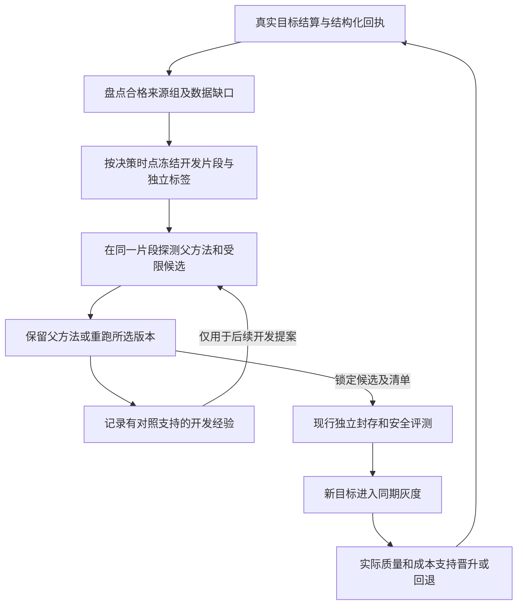

# Joi 工作台自主进化 · Harness RSI 研究与实施 tickets

2026-11-24 · RSI-01～03 可执行版本 · 源码 `ad7bd65`、方法合同 v2、AC-EVO-01～08

## 实施记录 · 2026-11-24

| Ticket | 工作树交付与证据 |
| --- | --- |
| RSI-01 | 迁移 116 固定来源归属，按根目标和已知同源关系归并旧标签。历史开发暴露会排除相关封存来源。在途旧清单需重新评测，历史账本保留。进化页显示聚合分母、拆分版本与预算。 |
| RSI-02 | 生产学习存储按工作台、轮次、双版本、结果成员和区间重建清单，公开状态只显示计数。迁移 117 保存新读取的驻留及授权指纹。历史未知驻留只支持固定轨迹分析。备份副本经 Joi 正式迁移和回放入口，五轮均为 3→2 次底层读取，逐页内容和引用一致。 |
| RSI-03 | 进化页新增显式开发对照，使用同一持久调用账本和前台优先的调度槽。隔离测试完成父方法与候选各三次，分别统计底层读取、工具请求、模型调用与 Token。五轮备份片段绑定 Anthropic 协议来源，真实六次试验仍待匹配的来源与模型版本。 |
| RSI-04 | 经验检索排除同组和不匹配的父方法或模型。追加开发动作、成本和反例。真实影子对照观察到工具请求差异后，预算允许时开启经验开关对照，并复跑所选候选。新独立来源上的真实实验仍待观察。 |
| RSI-05 | 封存锁定方法、来源组、评测身份和尝试数。全局至少覆盖两个工作台，候选封存严禁跨实验复用。页面给出试验完成数、复用基线、锁定时的预估新增调用和阶段实付。独立评测通过仍进入试用。 |
| RSI-06 | 新试用方法登记创建后进入的 30 天队列，采用按候选分页的同期匹配，保留试用比例、安全回退与反馈回退。页面显示裁决时点、样本数、质量区间、实际调用和成本。真实首个候选与其观察窗口仍待产生。 |

## 决策

**先修正来源分组，再在一个真实开发来源上验证证据页复用。** 本地备份已证明同一成功读取可以在离线回放中复用。首发范围是同一目标、同一轮、同一需求和结果版本、同一来源与读取区间的权威结果页。实现后用固定模型对照，测量模型自身是否减少发出重复读取请求。

进化提案可以从一个合格开发来源起步。能否封存须在修正分组后逐实验重新计算。生产收益来自候选创建之后的合格新目标。[现行 ADR](../adr/0020-bounded-strategy-evolution.md) · [项目验收](../07-roadmap-and-acceptance.md)

## 小型验证结果

| 验证项 | 2026-11-24 实数及结论 |
| --- | --- |
| 工作台盘点 | 25 个工作台、48 个可见目标、7 个启用且未暂停、8 个有开发来源、2 个实验复现过缺陷，灰度和生效均为 0。一个实验有 6 个封存组，21 次调用后被判候选无效。另一个实验 94 次调用后只有 3 个封存组。 |
| 来源独立性 | 独立备份 schema 113 保存 150 条 v2 案例，涉及 18 个根目标和 30 个现有组标签。5 个根目标存在多个组标签，2 个根目标同时出现在开发与封存。现有组标签不能直接用于计算独立样本。 |
| 回执筛查 | 1,571 条区间回执，覆盖 10 个目标。8 次额外同页读取分布在 2 个目标，7 个历史轮次。5 次来自同一开发根目标的 5 个完成版本，另外 3 次的结果为继续或阻塞。入选目标在库中有 3 个旧组标签，试点按 1 个来源计。 |
| 实际回放 | 5 个历史轮次均有需求快照、结果区间、模型来源标识和已结算的验收状态。父方法按原轨迹读取 15 次，复用方法读取 10 次。每轮均为 3→2，并保持逐页证据摘要、顺序、已验证引用覆盖等价。关键负对照覆盖不同区间、不同结果版本、失败验收和新轮次冷缓存。 |

回放固定 15 次历史工具动作，5 个重复动作由复用层提供相同页面。底层读取下降 **33.3%**。两臂沿用同一历史结算作为独立判分依据，核对引用覆盖是否变化。此次证据支持读取复用和回放清单设计。新的模型决策、模型调用量、Token 和生产收益均有独立验收项。

本次盘点与回放使用用户提供的离线备份，以只读方式查询；脚本在 `tmp/rsi-snapshot-census.mjs` 与 `tmp/rsi-snapshot-replay.mjs`，只输出聚合数、版本号与判分。打开备份前已用临时库或内存数据验证查询和复用边界。已有 5 个定向测试文件的 91 项检查通过。

## 研究如何改变设计

| 资料 | 作者实际做了什么 | 对 Joi 的取舍 |
| --- | --- | --- |
| 用户指定的 [CloudNavi 解读](https://cldnavi.com/zh/blog/harness2-google-research-2026/) 与 [Harness² 原论文 §§2.2–2.3](https://arxiv.org/html/2610.14224v1) | 固定执行模型和环境，用同一任务探测通用候选和领域候选，比较行为和交付物。Compose 可以保留父版本。组合后的方法还要执行一次。跨任务保留采用的方法和由对照支持的经验。 | 在后台影子实验中比较父版本和受限变体，研究试点允许保留父版本。先做一个决策片段，开发对照只支持下一次提案。正式发布仍要求独立验收。 |
| [Harness² 官方实现](https://github.com/google-research/harness2) | 区分基准执行、独立判分和报告。作者的无模型演示可演示编排，带模型的基准运行单独计量。 | 每个结论附实验清单、成本和证据等级。论文报告的三个专业基准提升不能用于推算 Joi 用户的实际收益。 |
| [ModularRSI](https://arxiv.org/abs/2609.14857) | 比较同一任务的成功与失败轨迹，再跨任务定位可迁移缺陷。模块独立演化，训练任务与下游评测分离。 | 保留现有单模块变更和来源组切分。新加“哪一步会改变”及其可观测预期。 |
| [RRSI](https://arxiv.org/abs/2609.24972) | 限制提案编辑预算，用批评与裁剪抑制题目特化、无效编辑和开销。 | 第一轮维持窄搜索。在开发对照中剔除无增益项，用新来源组检验经验能否迁移。单独核算学习开销及运行时收益。 |

## 架构诊断

1. **有反馈，但启动位置偏晚。** `MethodLearningService` 已有协议预检、开发基线、提案、候选验证、封存、灰度、回退和用量账本。提案能读取至多四条满足模型来源、父方法、适用条件、缺陷等约束的开发经验。现行流程在开发基线发现问题后，要有五个独立封存组才进入付费提案。低频工作台可以长期看见缺陷，却从未产生一次同任务候选对照。建议独立设置一个限额的开发探测入口，保留正式评测门槛。[实验编排与经验检索](../../src/main/application/evolution/method-learning-service.ts)
2. **现有重放容易掩盖真实决策难点。** 生产案例把目标压成三份结构登记，暴露覆盖数、失败数、重复读取数。依赖题的提问甚至给出三项任务及预期依赖顺序。这能检验模型是否执行规则，但真实任务可能是在结项之前没有找到证据。将事后总数带回当时的输入，会让基线也轻易答对。反之，历史有重复读取，也不能推出基线在模拟器会重复读。新片段须严格区分“决策当时可见”和“事后判分”。[案例转换](../../src/main/domain/evolution/learning-case.ts) · [重放器](../../src/main/domain/evolution/learning-replay.ts)
3. **正式评测有可计算的成本。** 最小封存配置是 30 个安全场景和 5 个独立业务组，父方法、候选各 3 次，共 210 个试验。试验包含多次模型动作。按冷缓存、每次安全题读两份记录再提交、业务题读三份再提交的全通过路径，光封存阶段就需 `30×6×3 + 5×6×4 = 660` 次调用。默认共享日额度 150，对应至少 5 个额度日。失败可早停，暖缓存可省调用，依赖计划、提案及重试另计。应显示剩余试验、缓存命中和预算日，避免让用户靠在线时长判断是否停滞。[场景定义](../../src/main/domain/evolution/scenarios.ts) · [独立评测](../../src/main/domain/evolution/learning-evaluation.ts)
4. **灰度结论受真实流量和样本选择影响。** 当前约 20% 分流，至少 5 个可评价候选及 5 个独立匹配对照。按 5 对计算，多通过 1 个目标的成功率差就是 20 个百分点。代码按时间倒序读最近 1,000 个目标绑定，再筛候选并取最近 5 个匹配；反复截窗会使后来的结果改变比较人群。建议按候选登记同期队列、预定观察窗口与决策时点，单列排除及不确定性，安全回退继续逐目标生效。[生产监控](../../src/main/application/evolution/method-learning-service.ts) · [目标绑定查询](../../src/main/infrastructure/persistence/sqlite-method-learning-store.ts)

## 现有数据的可用程度

9 月旧版最初 112 个目标产出 1 条可评价证据。收率修复后的历史分类对照得到 34 个可评价、5 个验收失败，使用量分散在二十余个工作台。另一阶段有 43 次已计费调用在响应处理环节失败。2026-11-24 已用认证 API 和独立备份核对当前 v2。本次的小型验证与早期历史采用各自口径。[历史取证与修订](../adr/0020-bounded-strategy-evolution.md)

| 存量 | 今天可以用于什么 | 决定能走多远的缺口 |
| --- | --- | --- |
| 需求/结果版本、客观验收、需求覆盖、证据归属、依赖与目标状态 | 重建符合现行合同的结构案例和结项标签，按稳定来源组去重 | 每个输入条件有几个独立开发缺陷组、几个封存组？现行来源标识可识别规范化文本相同的来源，改写、派生、重开还需核对血缘。不同缺陷行与重复快照不能充当新组。 |
| 工具读取回执、目标与 Work 的用量观察 | 找同一轮、双版本、工具、结果、游标和模式一致的重复读取；估算可节省的调用 | 老目标是否有回执、决策前证据和可区分的分页边界？缺回执属于未知。Token 缺失时只用可计量指标；宣称 Token 收益须有完整配对。 |
| 开发轨迹、方法、既有对照经验、试验缓存、版本与调用账本 | 复用兼容基线，筛去曾在相同条件下退化的候选，估算下一轮花费 | 仓库只保留每个工作台最近 200 条**未被实验引用**的案例，实验引用另行保留。缓存筛选要包含模型、方法、工具、评测器、案例和尝试身份。历史表行数不表示可重放数量。 |
| 历史对话、摘要、模型自评、旧批次、合成安全题 | 提供缺陷线索、协议与安全回归 | 普通对话可继承方法，但没有当前目标验收和分流资格。旧批次、用户未反对、模型自评都不能补生产对照。 |
| 新目标的版本绑定、灰度资格、同期验收和归属成本 | 对已有真实 CANARY 可查历史暴露；对新候选可前瞻取样 | 新候选在旧目标上没有暴露。跨模型来源、重开或不可评价的执行单独列出；归因必须能追溯到候选。 |

表的依据是 [SQLite 事实与用量投影](../../src/main/infrastructure/persistence/sqlite-method-learning-store.ts)、[持久化合同](../../resources/migrations/083_method_learning.sql) 和 [方法注册表](../../src/main/domain/evolution/learning-policy.ts)。

**样本决策。** 一个具备决策前输入、独立标签且能复现行为的开发来源组，就足以启动首个影子对照。相同作用域与输入条件的独立封存组数记作 S，正式评测至少还缺 `max(0, 5−S)` 组，并需满足所选质量或效率通道的复现条件。对全局方法还须核实跨台覆盖。生产阶段只使用新版本的合格分流。举例，若有 25 个合格且相互独立的新目标，假设哈希近似均匀，20% 分流下期望 5 个候选，但抽到至少 5 个的概率只有约 58%，再扣除无验收、版本变化和无法匹配，实际可用数还会下降。25 是容量估算，不能作为通过条件。

## 建议的运行链路

探测默认关闭，由参与工作台开启并设置每轮调用上限。开发片段在所属工作台隔离重放，只读工具返回冻结版本的结构材料。新实验继续走现有预算、单执行槽、outbox 和幂等调用身份，前台优先。权限、人格、验收定义及对外副作用不属于候选的修改范围。

## 实施 tickets

下列编号是本地计划标识。实施每张行为票时先提交可复现的失败断言，按受影响的 domain、application、SQLite、HTTP 和 renderer 选定检查。实验用临时库，真实效果走已授权工作台的产品入口。

### RSI-01 · P0 · 固定来源归属并显示实验就绪情况

**依赖**　无。**交付**　按稳定业务根目标归并历史快照，用可证实的派生、续跑或重复来源关系合并根目标。首次进入学习时持久化来源和拆分版本，随后编辑正文、重开或更换版本沿用归属。在读投影上显示各阶段分母、数据版本和截至时间。

- [ ] 迁移前回归复现同一根目标被分到多个组或两侧。迁移幂等，保留旧账本和实验快照。开发已见与封存相交的整组退出新封存评测，避免把曾参与提案的案例重新作为独立材料。受影响的在途实验要求重新锁定样本清单并换评测身份。
- [ ] 进化页分别给出已收敛、有效双版本和客观验收、去重来源、可重放开发、可用封存组的分母。摘要显示兼容封存组 S、剩余组数与预算、前台占用、候选无效等明确阻塞。协议错误和候选结构错误分别投影。
- [ ] 对本次备份的 5 个多标签根目标与 2 个双侧根目标做脱敏回归。验证同一历史片段换正文或版本仍只计一次，跨台合并需要可证实的来源关系。HTTP 和前端只显示聚合字段。

### RSI-02 · P0 · 重建一个可评分的历史决策片段

**依赖**　RSI-01。**交付**　从真实需求快照、结果成员和区间回执重建部分历史读取轨迹。清单冻结工作台、目标、轮次、双版本、结果来源、区间、模型来源与父方法。事后结算仅给判分端。现有回执覆盖不了的上下文驻留或压缩状态，在新轮次增加有界采样。

- [ ] 正式学习入口能生成一个开发来源的回放清单，对 5 个历史版本复算原轨迹的 15 次读取、10 个可复用页面。按 SQLite Unicode 码点解释区间，校验来源归属和读取时版本。历史片段沿用权威合成结算验证引用。来源、范围或父方法缺失时返回可定位的分型。
- [ ] 新轮次在成功读取时冻结双版本、区间、上下文驻留与失效事实。不同游标、陈旧版本、失败结果、权限变化、压缩移出证据以及跨轮次均覆盖反例。
- [ ] 回放试验只读隔离，输入只暴露决策时有效材料。终态验收、历史最终输出与事后覆盖统计留在判分端。同一清单可幂等重建且报告的独立来源数稳定。

### RSI-03 · P0 · 在少样本工作台跑完一次同任务影子对照

**依赖**　RSI-02。**交付**　新增低成本开发模式。即使 S 小于 5，也可在可重放开发片段上比较父方法和一个单模块候选，完成保留、采用或丢弃的决策记录。这个模式的输出仅进入开发区。

候选只改上下文模块。在回放边界注册同版本证据复用，查验归属、双版本和上下文驻留后，向模型提供已读回执引用。保留原结果工具的授权、分页、校验和验收语义。失效后允许按原入口重新读取。候选及重放器版本纳入缓存键。

- [ ] 确定性对照以 5 个历史轮次为回归目标，逐页证据、顺序和引用支持等价，底层读取复算为 15→10。压缩、版本改变、权限改变、失败结果和不同页面各有绕开复用的回归。
- [ ] 开发模式用一个开发来源、一名候选、父方法与候选各三次真实模型试验。固定模型来源、版本、权限、输入与调用上限。独立判分器确认权威验收没有退化。记录底层读取、工具请求、模型调用和已知 Token，对零空间、无收益和退化分别出裁决。只有实测变化才可归入对应收益。
- [ ] 沿用单槽、前台优先、预算预留、outbox 和恢复幂等。封存不足可做开发对照，输出只留开发区。无效候选按结构、已淘汰重复、开发依据不匹配等有限原因区分，保留停止或选择父方法的路径。

### RSI-04 · P1 · 让上一次实验改善下一次提案

**依赖**　RSI-03。**交付**　扩展现有数值经验检索。每条经验带有条件、父子方法、观察到的动作变化、失败反例、适用域和成本。保持本台私有及全局可共享结构摘要的边界。

- [ ] 新来源组上的开发实验以相同预算、相同随机化协议对照“检索经验／关闭检索”。预先确定指标为找到合格候选的调用数及其质量；没有差异或变差也记录。
- [ ] 同源改写或已作提案依据的案例不能充当迁移证据，封存结果不能进入提案上下文。证据不足时跳过写入，重复负例能阻止同条件下再次付费。
- [ ] 候选预算支持一个通用和一个本台变体的受控比较。仅在 RSI-03 有可测动作差异、且预算可覆盖时开启第二候选。选定或组合后的方法重新执行；仍只改变一个注册模块。

### RSI-05 · P1 · 让封存成本、独立性和裁决可以复算

**依赖**　RSI-03。**交付**　冻结方法、评测器、来源组、拆分与尝试清单。在评测视图显示可复用基线、预计新增调用、完成进度、全成本和拒绝原因。可先验证首个候选，无需等待经验库升级。

- [ ] 同源组跨版本或跨台不得同时出现在开发和封存。全局候选验证至少两个工作台的符合条件来源。验证缺五个独立组、隐藏答案泄漏、换 pin、续跑和旧缓存失效。
- [ ] 保留 30 个安全场景、至少 5 个独立业务封存组、每臂各三次、零硬违规、各场景不退化及既有收益阈值。质量成功率至少提高 5 个百分点且调用与已知配对 Token 增幅各不超过 10%；效率要求质量不降，调用或完整 Token 降低至少 15%，另一项不增加。
- [ ] 展示各臂原始计数与分母、缺失 Token 比例、开发及封存各阶段花费。封存耗尽、重复试探或更换评测器需新身份和独立评测记录；通过仅产生 CANARY。

### RSI-06 · P1 · 用新目标证明生产收益并能回退

**依赖**　RSI-05。**交付**　保留稳定约 20% 分流，在首次暴露时登记候选专属队列、资格、观察窗口及主指标；回看时能解释每个分母的变化。查询按候选范围分页，消除全局最近 1,000 条绑定对长期实验的截断影响。

- [ ] 预注册判定时点和所需样本量，以同期同条件基线为对照，至少 5 个候选及 5 个独立匹配对照。面板展示组数、效果差、区间估计及样本不足原因。小样本标为初步观察；按预先确定的解释规则作生产收益声明，禁止挑最好的时间窗。
- [ ] 比较权威质量、目标级调用和可计量 Token，同时单列为学习支付的预检、开发、封存及失败成本。效率通道给出回本所需目标数；缺任一计量项则注明未知。
- [ ] 复验新旧目标绑定、跨台作用域、重开/撤销、来源切换、30 天超时、安全父版本和明确负反馈回退。输出首个真实候选的匿名裁决单，可为晋升、回退、未达收益或流量不足。后两者不计已产生收益。

## 排期与退出条件

第一阶段交付 RSI-01～03。若没有可重建片段，停在 RSI-02 的前瞻采集；若出现协议失败，先修协议兼容性再恢复探测。若在客观验收持平的前提下看到动作或成本差异，RSI-04 与 RSI-05 可并行。RSI-06 由封存通过及真实新流量驱动。**首个生产成果**须有一张真实、可复算、可回退的生产裁决单且收益达标。**跨任务递归收益**还需 RSI-04 的新来源组经验开关对照成立。
